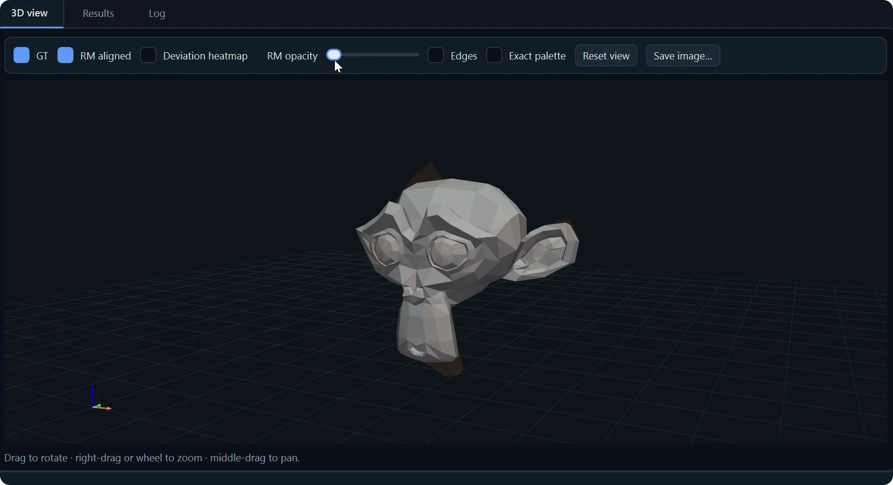
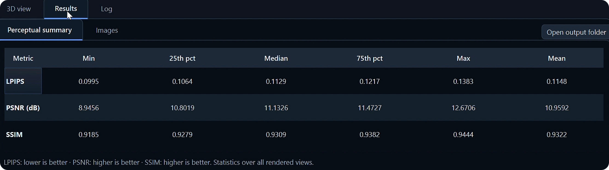
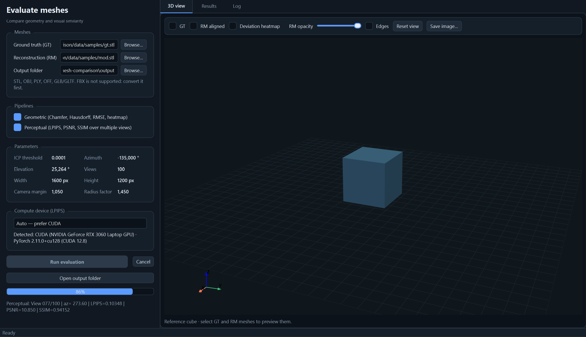

<p align="center">
  
</p>

<h1 align="center">Mesh Comparison: Mesh Evaluation</h1>

<p align="center">
  <a href="https://github.com/lianeheidemann/mesh-comparison/actions/workflows/ci.yml">
    
  </a>
</p>

<p align="center">
  <picture><source media="(prefers-color-scheme: dark)" srcset="https://img.shields.io/badge/Python-3B4A5A?style=flat-square&logo=python&logoColor=white"></picture>
  <picture><source media="(prefers-color-scheme: dark)" srcset="https://img.shields.io/badge/NumPy-3B4A5A?style=flat-square&logo=numpy&logoColor=white"></picture>
  <picture><source media="(prefers-color-scheme: dark)" srcset="https://img.shields.io/badge/Trimesh-3B4A5A?style=flat-square"></picture>
  <picture><source media="(prefers-color-scheme: dark)" srcset="https://img.shields.io/badge/Open3D-3B4A5A?style=flat-square"></picture>
  <picture><source media="(prefers-color-scheme: dark)" srcset="https://img.shields.io/badge/PyTorch-3B4A5A?style=flat-square&logo=pytorch&logoColor=white"></picture>
  <picture><source media="(prefers-color-scheme: dark)" srcset="https://img.shields.io/badge/LPIPS-3B4A5A?style=flat-square"></picture>
  <picture><source media="(prefers-color-scheme: dark)" srcset="https://img.shields.io/badge/PySide6-3B4A5A?style=flat-square"></picture>
  <picture><source media="(prefers-color-scheme: dark)" srcset="https://img.shields.io/badge/PyVista-3B4A5A?style=flat-square"></picture>
  <picture><source media="(prefers-color-scheme: dark)" srcset="https://img.shields.io/badge/PyVistaQt-3B4A5A?style=flat-square"></picture>
</p>

This workspace compares a ground-truth mesh (GT) with a reconstructed mesh (RM), combining geometric distance metrics with perceptual image metrics across multiple camera views. Run evaluations in the desktop interface or call the pipeline functions from Python. One **planned research use case** is to evaluate meshes generated by different image-to-3D AI systems from the **same reference image**, against a known GT mesh, using comparable and reproducible quality criteria. The application currently evaluates **one GT/RM pair per run**; automatic cross-generator benchmarking or ranking is not implemented.

<p align="center">
  
</p>

**Quick links:** [Single-view 3D evaluation](#single-view-3d-reconstruction-evaluation-context) · [Meshy](https://www.meshy.ai/pt-PT) · [Tripo AI](https://www.tripo3d.ai/pt) · [Installation](#installation) · [Desktop interface](#desktop-interface) · [Windows validation](#validate-on-windows) · [Technical documentation](docs/) 

### Table of contents

- [Single-view 3D reconstruction: evaluation context](#single-view-3d-reconstruction-evaluation-context)
- [Example results](#example-results)
- [Technologies](#technologies)
- [Workspace layout](#workspace-layout)
- [Requirements](#requirements)
- [Installation](#installation)
- [Desktop interface](#desktop-interface)
- [Validate on Windows](#validate-on-windows)
- [Pipelines](#pipelines)
- [Parameters](#parameters)
- [Scope and limitations](#scope-and-limitations)
- [Development](#development)
- [Troubleshooting](#troubleshooting)
- [License and credits](#license-and-credits)

---


The diagram shows the **evaluation flow**. In the desktop app, `gui/runner.py` starts a `gui/worker.py` child process for each selected pipeline; selecting both runs them sequentially. Python callers can invoke either pipeline's `run_pipeline(...)` function directly. The detailed module and GUI flow is in the [implementation guide](docs/implementation/README.md).

## Single-view 3D reconstruction: evaluation context

**Single-view 3D reconstruction** attempts to infer a 3D object from **one 2D image**. In the planned controlled comparison, the original 3D mesh is available as **ground truth (GT)**; a single image rendered from that GT is supplied unchanged to several external generative AI image-to-3D tools (for example, **[Meshy](https://www.meshy.ai/pt-PT)** and **[Tripo AI](https://www.tripo3d.ai/pt)**). Each tool returns a **reconstructed mesh (RM)**. Mesh Comparison is used downstream to evaluate each generated mesh against the same GT.

**External image-to-3D platforms:** [Meshy — official website](https://www.meshy.ai/pt-PT) · [Tripo AI — official website](https://www.tripo3d.ai/pt)

### Planned comparison across generative 3D models

```text
Known original mesh (GT)
          |
          v
Render ONE reference image (same 2D input for all generators)
          |
          +------------------------+----------------------+
          |                        |                      |
          v                        v                      v
     Meshy image-to-3D        Tripo AI image-to-3D       Other AI models
          |                        |                      |
          v                        v                      v
     Generated mesh A         Generated mesh B        Generated mesh C
          |                        |                      |
          +------------------------+----------------------+
                                   |
                                   v
                Evaluate EACH reconstructed mesh against GT
                                   |
                  +----------------+----------------+
                  |                                 |
                  v                                 v
       Geometric comparison                 Perceptual comparison
       ICP (when needed),                   Matched multi-view renders;
       Chamfer, Hausdorff, RMSE,            PSNR, SSIM, LPIPS
       and distance heatmaps
                                   |
                                   v
          Compare metric results under a consistent protocol
```

### Brief overview of evaluation criteria

| Evaluation criterion | Methods | What it helps assess |
| --- | --- | --- |
| **Geometric fidelity** | Chamfer Distance, Hausdorff Distance, RMSE | How closely the generated surface approximates the GT; lower distances are generally better, under the same units and sampling protocol. |
| **Alignment** | Conditional ICP | Accounts for pose differences before measuring shape, where appropriate. Alignment is a preparation step, **not** a standalone quality score; it must not conceal meaningful scale or shape errors. |
| **Localized deviations** | Geometric distance heatmaps | Shows **where** surfaces diverge, not just how much they differ on average. |
| **Perceptual / rendered similarity** | PSNR, SSIM, LPIPS from matched camera views | Compares visual outputs under consistent viewpoints and rendering conditions. Generally, higher PSNR/SSIM and lower LPIPS indicate greater similarity. |

**Fair-comparison protocol (planned):** use the **same source image and GT** for every generator, standardize preprocessing and mesh preparation, hold camera positions, rendering conditions, metric parameters and sampling strategy constant, and record tool/model versions and generation settings. If a generator is stochastic, repeated outputs may be needed to characterize variation. Report individual metrics and relevant qualitative findings; do not claim one model is categorically superior based on a single score, an unvalidated weighted ranking, or one test object.

**Project boundary:** Mesh Comparison **does not generate 3D meshes from images** and does not accept the source photo in place of a GT/RM mesh. Image-to-3D generation happens **outside** the project. The existing application analyzes **one supplied GT/RM pair at a time**, so running the same evaluation separately for multiple AI-generated RMs is a proposed workflow, **not an automated benchmark or a completed comparative study**. The committed example meshes do not establish the reconstruction method used to create the RM.

**Terminology:** *Single-view 3D reconstruction* names the task of reconstructing 3D geometry from one image. *One-shot* may be used informally, but *one-shot learning* has a distinct machine-learning meaning and is not a precise synonym.

**Interpretation:** A single source image cannot directly reveal all hidden surfaces or resolve every depth ambiguity. A reconstruction that looks convincing from that view may differ substantially from the true geometry. Here, **multiple views are used for evaluation** after reconstruction; they are not additional images supplied to the upstream image-to-3D model. Metric values depend on the chosen alignment, scale, mesh sampling, camera settings, and rendering conditions.

## Example results

The images below are sample outputs from the geometric and perceptual pipelines. This recorded run used 100 camera views; the pre-alignment normalized MSE was below the configured threshold, so ICP alignment was skipped.

**Execution status:** both pipelines completed without errors with the repository's example meshes. This confirms the example workflow in the recorded Windows environment; it is not a systematic test of varied mesh conditions. That environment uses CPU-only PyTorch, so CUDA acceleration was unavailable and was not tested.

### Metric snapshot

**Geometric metrics** (reported in the original GT mesh units):

| Metric | Result | Direction |
| --- | ---: | --- |
| Mean Chamfer distance | 0.00706686 | Lower is better |
| Symmetric Hausdorff distance | 0.308021 | Lower is better |
| Symmetric RMSE | 0.0322591 | Lower is better |

**Perceptual metrics** (median across 100 views):

| Metric | Result | Direction |
| --- | ---: | --- |
| LPIPS | 0.112826 | Lower is better |
| PSNR | 11.1308 dB | Higher is better |
| SSIM | 0.930943 | Higher is better |

These values describe this example run. Compare results only when the inputs, camera views, and pipeline settings are consistent. STL files do not store physical units, so geometric values use the unit system of the GT mesh.


### Perceptual summary — desktop screenshot

<p align="center">
  
</p>

*Screenshot of the perceptual summary for the example GT/RM mesh pair.* Lower LPIPS is better; higher PSNR and SSIM are better under comparable settings. The screenshot's rounded values differ slightly from the versioned [example perceptual CSV](examples/output/metrics/metrics_perceptual.csv) above, so treat them as separately recorded results until the respective run settings and metadata are matched. This is **not** a completed benchmark of different generative AI tools.

<table>
  <tr>
    <td width="50%" align="center">
      <strong>Ground-truth mesh (GT)</strong><br>
      
    </td>
    <td width="50%" align="center">
      <strong>Aligned reconstructed mesh (RM)</strong><br>
      
    </td>
  </tr>
  <tr>
    <td colspan="2" align="center">
      <strong>Geometric distance heatmap</strong><br>
      
    </td>
  </tr>
  <tr>
    <td colspan="2" align="center">
      <strong>Perceptual comparison — view 1</strong><br>
      
    </td>
  </tr>
</table>

The [full example report](docs/results/README.md) (currently in Portuguese) contains all metrics, metadata, and additional views.

## Technologies

| Technology | Recorded or pinned version | Role in the project |
| --- | --- | --- |
| Python | 3.12.15 (Windows environment lock) | Main language for both evaluation pipelines. |
| Conda | 25.11.1 (reported Windows version; not pinned) | Isolated Python environment and dependency management. |
| NumPy | 2.5.4 | Numerical operations on coordinates, arrays, and distances. |
| Trimesh | 5.1.1 | Loading, inspecting, transforming, and exporting 3D meshes. |
| Open3D | 0.20.0 | Iterative Closest Point (ICP) mesh alignment. |
| SciPy (cKDTree) | 1.18.1 | Efficient nearest-neighbor searches for geometric metrics. |
| pyrender | 0.1.45 | Offscreen rendering of meshes for image-based comparison. |
| Matplotlib | 3.11.2 | Geometric distance visualization and heatmap color mapping. |
| imageio | 2.38.1 | Writing rendered images to disk. |
| PyTorch | 2.14.1 (CPU lock); 2.11.0+cu128 (Windows CUDA snapshot) | Neural-network execution for perceptual evaluation. |
| torchvision | 0.29.1 (CPU lock); 0.26.0+cu128 (Windows CUDA snapshot) | Vision models and utilities used by LPIPS. |
| LPIPS | 0.1.4 | Learned perceptual similarity between rendered views. |
| scikit-image | 0.26.0 | Structural Similarity Index (SSIM) calculation. |
| pandas | 3.0.6 | Tabular metrics, summaries, and CSV exports. |
| PySide6 | 6.12.0 (Windows pip snapshot) | Qt framework for the desktop interface. |
| PyVista | 0.49.1 (Windows pip snapshot) | 3D visualization using VTK. |
| PyVistaQt | 0.13.1 (Windows pip snapshot) | Embeds the PyVista viewer in the Qt interface. |

The Windows `meshEval` lock snapshot was recorded on 2026-10-17. Its Python and package pins are in [`environment-lock.yml`](environments/environment-lock.yml); the Conda executable version `25.11.1` was reported for that environment but is not captured in the lock file. The lock uses CPU PyTorch (`2.14.1+cpu` in the recorded environment). [`requirements-windows-cu128.txt`](environments/requirements-windows-cu128.txt) is a separate pinned Windows pip snapshot with CUDA 12.8 wheels, including different PyTorch and torchvision versions and the GUI packages. The general [`environment.yml`](environments/environment.yml) and the extras in [`pyproject.toml`](pyproject.toml) leave dependency versions unpinned, so new installs may resolve differently. These are recorded setup versions, not a claim that the refactored package was retested with each snapshot; the committed [example results](docs/results/README.md) are historical as well.

## Workspace layout

```text
mesh-comparison/
├── README.md  LICENSE  pyproject.toml
├── src/meshcomparison/            # Python package
│   ├── common/                    # Shared: mesh I/O, preparation (scale + ICP), distances, rendering, device detection
│   ├── geometry/                  # Geometric evaluation (pipeline, metrics, heatmap)
│   ├── gui/                       # Desktop: config, panels, runner/worker, outputs, results and 3D viewer (PySide6/PyVistaQt)
│   └── perceptual/                # Multi-view perceptual evaluation (cameras, PSNR/SSIM/LPIPS)
├── data/samples/                  # gt.stl (ground truth) and mod.stl (reconstructed mesh)
├── environments/                  # environment.yml (general), environment-lock.yml (Windows snapshot) and requirements-windows-cu128.txt (pip snapshot, CUDA 12.8)
├── examples/output/               # Committed results of the sample run
│   ├── aligned/                   # Aligned reconstructed mesh exports
│   ├── heatmaps/                  # Geometric distance heatmap assets
│   ├── metrics/                   # CSV metric reports
│   └── renders/                   # Mesh and view renders (gt/, rm/, pairs/)
├── docs/                          # Geometric concepts, implementation, GUI and harness guides
└── tests/                         # pytest suite
```

The sample meshes in `data/samples/` (`gt.stl` as the ground truth, `mod.stl` as the reconstructed mesh) are the ones to try first; the interface writes results to the output folder you choose (default: a local `output/` folder, git-ignored). The results committed in `examples/output/` come from the sample run. Runs may replace files with the same names in the output folders.

The standard workflow uses the desktop interface. It starts each pipeline in a separate child process (`meshcomparison.gui.worker`), so rendering never shares an OpenGL context with the 3D viewer and a run can be cancelled. The pipelines remain available as Python functions (`meshcomparison.geometry.pipeline.run_pipeline`, `meshcomparison.perceptual.pipeline.run_pipeline`) for scripts and notebooks; the former command-line interfaces and launch scripts have been removed.

## Requirements

Use Python in a Conda environment named `meshEval` (or a virtual environment, see below) to run the interface. The package imports NumPy, pandas, trimesh, pyrender, Open3D, Matplotlib, imageio, and SciPy. The perceptual pipeline additionally imports scikit-image, PyTorch, and LPIPS. A working offscreen-rendering setup is needed for `pyrender`; the perceptual pipeline uses CUDA when available and otherwise runs LPIPS on CPU.

## Installation

Open **Anaconda Prompt** in the repository folder. Create the environment only if it does not already exist:

```bat
conda env create -f environments/environment.yml
```

Then activate it and install the project:

```bat
conda activate meshEval
python -m pip install -e . --no-deps
```

If Conda reports `prefix already exists`, the environment is already there. Skip `conda env create` and run the activation and install commands above. The `environment.yml` file includes the desktop interface dependencies. The `--no-deps` option registers the project without installing its dependencies, so an older environment may still need the GUI packages:

```bat
python -m pip install PySide6 pyvista pyvistaqt
```

**For a pinned Windows CUDA 12.8 setup**, create a virtual environment with Python 3.12 and install the pip snapshot, which points to the `cu128` PyTorch wheels:

```bat
python -m venv .venv
.venv\Scripts\activate
python -m pip install -r environments/requirements-windows-cu128.txt
python -m pip install -e . --no-deps
```

The [environment preparation guide](docs/implementation/step-by-step/01-preparacao-ambiente.md) has additional setup notes. To verify the pipeline dependencies, run:

```bat
python -c "import numpy, pandas, trimesh, pyrender, open3d, matplotlib, imageio, scipy, skimage, torch, torchvision, lpips; print('OK: libraries loaded')"
```

The previously recorded Windows environment had a **CPU-only PyTorch build**; that does not mean every installation of PyTorch on Windows is CPU-only. Check your environment first:

```bat
python -c "import torch; print('torch:', torch.__version__, 'CUDA build:', torch.version.cuda, 'CUDA available:', torch.cuda.is_available())"
```

For GPU-accelerated LPIPS, choose the **installation command matching your operating system, Python version and NVIDIA driver** from the [official PyTorch selector](https://pytorch.org/get-started/locally/). Recheck `torch.cuda.is_available()` afterward; this branch has **no recorded GPU end-to-end validation**. In the interface, **Compute device (LPIPS)** offers `Auto — prefer CUDA`, `CUDA only` (fails with an explanation if CUDA is unavailable) and `CPU only`. Only the LPIPS neural-network calculation selects that device; the geometric pipeline and the offscreen renderer are not made CUDA-accelerated by this option.

## Run

### Desktop interface

With the `meshEval` environment active, start the interface with:

```bat
mesh-gui
```

The window opens maximized, with the Windows title bar and taskbar visible. If that command is not found, use `python -m meshcomparison.gui`. If the window does not open and Python reports `No module named 'PySide6'`, install the interface packages with `python -m pip install PySide6 pyvista pyvistaqt`, then try again. The GUI needs a desktop session. See the [desktop GUI guide](docs/gui/README.md) for choosing meshes and running an evaluation.

## Validate on Windows

Use the **Anaconda Prompt** in the repository root, with the current branch checked out and the `meshEval` environment activated. This procedure checks the local PyTorch/CUDA installation, the desktop interface and the two sample pipelines; it **does not claim that a GPU or GUI test has already been run on your machine**.

### 1. Activate the environment and check CUDA

```bat
conda activate meshEval
python -m pip install -e . --no-deps
python -c "import torch; print(torch.cuda.is_available(), torch.version.cuda)"
```

- `True` followed by a CUDA version means PyTorch can currently use CUDA. The version is the CUDA build used by PyTorch, not a benchmark result.
- `False None` generally means a **CPU-only PyTorch build** is installed in this environment. If your computer has a compatible NVIDIA GPU, install a CUDA-enabled build.
- `False` with a CUDA version usually means the build includes CUDA but it cannot use a GPU; investigate drivers, GPU compatibility and the current environment rather than assuming a CPU-only installation.

**Example CUDA 12.8 wheel installation for a compatible Windows/NVIDIA setup** (replace this command with the one recommended by the [official PyTorch installation selector](https://pytorch.org/get-started/locally/) for your driver and supported version):

```bat
python -m pip uninstall -y torch torchvision
python -m pip install torch torchvision --index-url https://download.pytorch.org/whl/cu128
python -c "import torch; print(torch.cuda.is_available(), torch.version.cuda)"
```

The installation example is **not universal** and may not suit every driver, model or release. If CUDA cannot be enabled, choose `CPU only` under **Compute device (LPIPS)** to run LPIPS on the CPU; the geometric pipeline does not require CUDA.

### 2. Check the desktop interface

```bat
mesh-gui
```

Alternatively run `python -m meshcomparison.gui`. In the side panel under **Compute device (LPIPS)**, check that the detected device is displayed as **CUDA (your NVIDIA GPU name)** when CUDA is available. `Auto — prefer CUDA` should be selected to use it automatically. A CPU label or a warning means GPU acceleration for LPIPS has **not** been confirmed. Select `data/samples/gt.stl` and `data/samples/mod.stl` to preview the meshes in the 3D view.

### 3. Run both pipelines on the sample meshes

In the interface, select `data/samples/gt.stl` as **Ground truth (GT)** and `data/samples/mod.stl` as **Reconstruction (RM)**, set **Output folder** to a **new folder** such as `output/windows-validation` (both pipelines write `aligned/rm_aligned.ply`, so use a separate folder per experiment), keep both pipelines checked, leave **Compute device (LPIPS)** on `Auto — prefer CUDA` and press **Run evaluation**.

The perceptual pipeline evaluates **100 views** and saves views 1, 33 and 66, matching the recorded example (the parameters are fixed in the interface to the original pipeline's defaults). With `Auto`, LPIPS uses CUDA if available and otherwise falls back to CPU. The first LPIPS run may need model weights or a network connection, and rendering may require a working OpenGL environment. When the run finishes the interface opens the **3D view** with the deviation heatmap; tables and image pairs are in the **Results** tab.

### 4. Compare with the versioned example CSVs

Compare the newly produced files against `examples/output/metrics/*.csv`:

| Metric family | Recorded example | New Windows run |
| --- | --- | --- |
| Geometry | [`metrics_geometry.csv`](examples/output/metrics/metrics_geometry.csv) | `output/windows-validation/metrics/metrics_geometry.csv` |
| Perceptual summary | [`metrics_perceptual.csv`](examples/output/metrics/metrics_perceptual.csv) | `output/windows-validation/metrics/metrics_perceptual.csv` |
| Per-view metrics | [`per_view_metrics.csv`](examples/output/metrics/per_view_metrics.csv) | `output/windows-validation/metrics/per_view_metrics.csv` |

Optional commands for a quick side-by-side comparison of the principal values:

```bat
python -c "import pandas as pd; a=pd.read_csv('examples/output/metrics/metrics_geometry.csv'); b=pd.read_csv('output/windows-validation/metrics/metrics_geometry.csv'); cols=['mean_chamfer_gt_units','symmetric_hausdorff_gt_units','symmetric_rmse_gt_units']; print('Example:\n',a[cols].to_string(index=False)); print('Windows:\n',b[cols].to_string(index=False))"
python -c "import pandas as pd; a=pd.read_csv('examples/output/metrics/metrics_perceptual.csv'); b=pd.read_csv('output/windows-validation/metrics/metrics_perceptual.csv'); print('Example:\n',a[['metric','median']].to_string(index=False)); print('Windows:\n',b[['metric','median']].to_string(index=False))"
```

The recorded geometry values (in GT mesh units) are approximately **Chamfer 0.00706686**, **Hausdorff 0.308021**, **RMSE 0.0322591**. Recorded perceptual medians are **LPIPS 0.112826**, **PSNR 11.1308 dB** and **SSIM 0.930943**.

**Interpretation:** small LPIPS differences between CPU and GPU can occur. Renderer, library versions, camera parameters and floating-point differences can affect other metrics too. Compare values with appropriate numerical tolerances, not exact CSV-byte equality. A large difference, missing file or runtime error deserves investigation; it does not automatically prove either implementation is correct. The example CSVs are a **historical baseline**, not a validated acceptance threshold for every machine.

For more detail, see the [GUI guide](docs/gui/README.md), [environment guide](docs/implementation/step-by-step/01-preparacao-ambiente.md) and [validation plan](docs/implementation/step-by-step/10-limitacoes-evolucao.md).

## Pipelines

### Geometric evaluation

The geometric pipeline (`src/meshcomparison/geometry/`) uses the shared preparation function in `src/meshcomparison/common/prepare.py` to normalize both meshes using the ground-truth bounding-box diagonal and conditionally run similarity ICP (rotation, translation, and uniform scale) when pre-alignment normalized MSE exceeds the threshold. It measures symmetric nearest-vertex distances, writes one shared-view render per mesh and a ground-truth vertex-distance heatmap.

Main outputs (relative to the output folder; the committed sample run is in `examples/output/`):

- `output/metrics/metrics_geometry.csv`: pre/post-alignment MSE, mean Chamfer distance, symmetric Hausdorff distance, symmetric RMSE, alignment status, and transform metadata. Distance metrics are reported both normalized and in the original ground-truth units.
- `output/aligned/rm_aligned.ply`: aligned reconstructed mesh, exported in the input ground-truth scale.
- `output/renders/gt_ortho.png` and `output/renders/rm_aligned_ortho.png`: orthographic renders.
- `output/heatmaps/gt_heatmap_ortho.png`: rendered distance heatmap; `gt_heatmap_colored.ply` is the colored mesh used to create it.

### Perceptual evaluation

The perceptual pipeline (`src/meshcomparison/perceptual/`) uses the same shared mesh preparation and conditional ICP alignment, then renders the meshes across a rotating set of camera azimuths. It computes masked LPIPS, PSNR, and SSIM per view and summarizes their distributions. By default, it evaluates 100 views and saves views 1, 33, and 66.

Main outputs:

- `output/metrics/per_view_metrics.csv`: one row per view with LPIPS, PSNR, SSIM, camera angle, and framing values.
- `output/metrics/metrics_perceptual.csv`: min, max, 25th/75th percentiles, median, and mean for each perceptual metric.
- `output/metrics/run_metadata.csv`: input paths, alignment details, view settings, and the final transform.
- `output/aligned/rm_aligned.ply`: aligned reconstructed mesh in the ground-truth input scale.
- `output/renders/gt/`, `output/renders/rm/`, and `output/renders/pairs/`: saved images for the selected views.


## Parameters

The interface shows analysis parameters as **fixed values** configured in `RunConfig` (`src/meshcomparison/gui/config.py`): ICP MSE threshold `1e-4` (alignment runs only above it), render size `1600 × 1200`, elevation `25.264°`, geometric camera azimuth `-135°`, `100` perceptual views (images saved for views `1 33 66`), camera margin `1.05` and camera radius factor `1.45`. Images are saved only for the view numbers that exist.

To use other values from Python code, call the relevant pipeline's `run_pipeline(...)` with its supported keyword arguments. The geometric pipeline accepts `mse_threshold_normalized`, `azimuth_deg`, `elevation_deg`, `width` and `height`; the perceptual pipeline accepts `mse_threshold_normalized`, `elevation_deg`, `width`, `height`, `num_views`, `save_views`, `camera_margin`, `radius_factor` and `device`.

## Scope and limitations

- The application evaluates supplied GT/RM meshes; it does not generate a reconstructed mesh from a single image. A single-view reconstruction method must run separately.
- Comparing Meshy, Tripo AI or other image-to-3D generators using identical inputs and recorded settings is a **proposed study**, not an already completed experiment or an automatic multi-model ranking feature.
- STL files do not store physical units. Geometric distances use the unit system of the GT mesh.
- The GitHub Actions workflow checks linting, the tests and that the pipelines import. It does not run offscreen rendering or validate CUDA execution.
- LPIPS runs on CPU when CUDA is unavailable; results can depend on camera, framing, and pipeline settings.
- Basic unit tests already cover identical vertex clouds, a simple point offset and bounding-box scale/translation, plus perceptual helper and GUI-configuration behavior. **Systematic end-to-end validation on controlled meshes** (deformations, incomplete surfaces, different sampling densities and rendering regression) is still pending; see the [validation plan](docs/implementation/step-by-step/10-limitacoes-evolucao.md).

## Development

Implementation details are in the [technical guide](docs/implementation/README.md); the [desktop guide](docs/gui/README.md) covers the Qt/PyVista viewer; and [Harness documentation](docs/harness/README.md) describes the documented (not yet fully implemented) agent-development workflow.

`environments/environment.yml` also installs `pytest` and `ruff`. From the activated environment (with `pip install -e . --no-deps` done):

```bat
ruff check .
pytest
```

GitHub Actions (`.github/workflows/ci.yml`) runs lint, the tests and an import check of both pipelines and the worker. It does not run the rendering or CUDA parts of the pipelines.

## Troubleshooting

- **`pyrender` fails to create an offscreen context**: a working offscreen OpenGL setup is required. On headless Linux, install `libegl1 libgl1 libglu1-mesa libosmesa6` and set `PYOPENGL_PLATFORM=egl` (as the CI does).
- **CUDA not available**: expected on CPU-only installs; LPIPS then runs on CPU, just slower.
- **Cannot load an `.fbx` file**: FBX is rejected and is not converted by this application. Convert it outside Mesh Comparison to STL, OBJ, PLY, or another supported `trimesh` format, then load the converted file.

## Interface
<p align="center">
  
</p>

## License and credits

This repository is a fork of [ThiagoFigueiroRibeiro/MeshComparison](https://github.com/ThiagoFigueiroRibeiro/MeshComparison). The modifications in this fork are proprietary; see [LICENSE](LICENSE). Code derived from the original project remains the property of its author.

