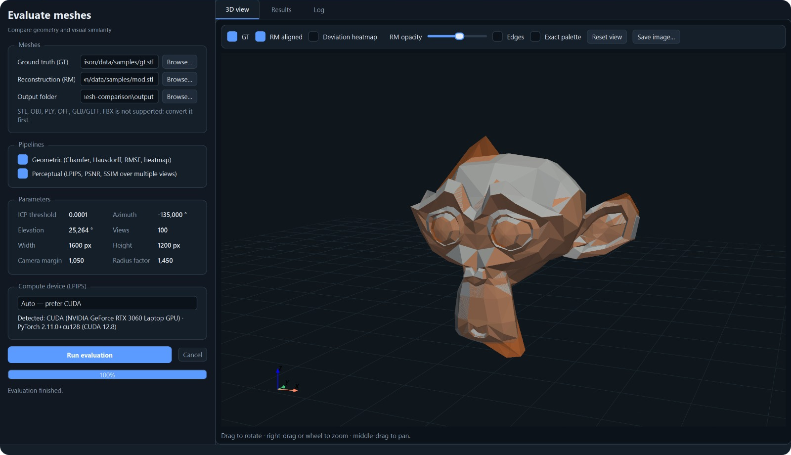
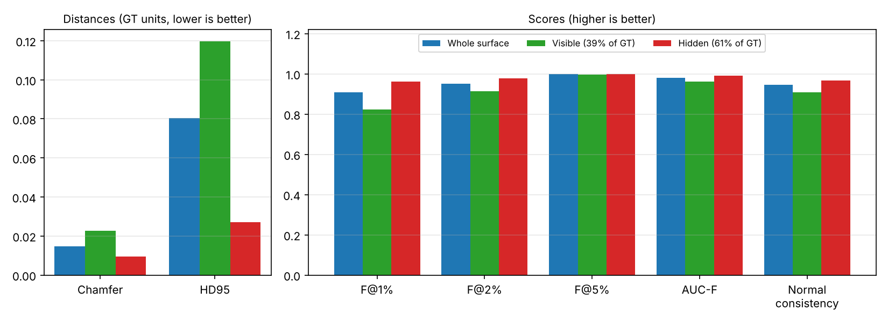
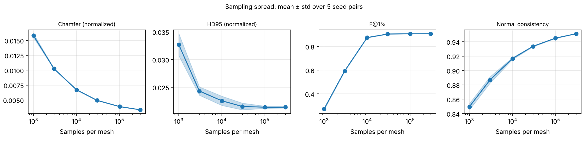

<p align="center">
  
</p>

<h1 align="center">Mesh Comparison: Mesh Evaluation</h1>

<p align="center">
  <a href="https://github.com/lianeheidemann/mesh-comparison/actions/workflows/ci.yml">
    
  </a>
</p>

<p align="center">
  <picture><source media="(prefers-color-scheme: dark)" srcset="https://img.shields.io/badge/Python-3B4A5A?style=flat-square&logo=python&logoColor=white"></picture>
  <picture><source media="(prefers-color-scheme: dark)" srcset="https://img.shields.io/badge/NumPy-3B4A5A?style=flat-square&logo=numpy&logoColor=white"></picture>
  <picture><source media="(prefers-color-scheme: dark)" srcset="https://img.shields.io/badge/Trimesh-3B4A5A?style=flat-square"></picture>
  <picture><source media="(prefers-color-scheme: dark)" srcset="https://img.shields.io/badge/Open3D-3B4A5A?style=flat-square"></picture>
  <picture><source media="(prefers-color-scheme: dark)" srcset="https://img.shields.io/badge/PyTorch-3B4A5A?style=flat-square&logo=pytorch&logoColor=white"></picture>
  <picture><source media="(prefers-color-scheme: dark)" srcset="https://img.shields.io/badge/LPIPS-3B4A5A?style=flat-square"></picture>
  <picture><source media="(prefers-color-scheme: dark)" srcset="https://img.shields.io/badge/PySide6-3B4A5A?style=flat-square"></picture>
  <picture><source media="(prefers-color-scheme: dark)" srcset="https://img.shields.io/badge/PyVista-3B4A5A?style=flat-square"></picture>
  <picture><source media="(prefers-color-scheme: dark)" srcset="https://img.shields.io/badge/PyVistaQt-3B4A5A?style=flat-square"></picture>
</p>

Mesh Comparison is a Python desktop application that evaluates a reconstructed mesh (RM) against a ground-truth mesh (GT): geometric accuracy and completeness on the surface, accuracy in regions hidden from the input image, and perceptual similarity over multiple rendered views. It evaluates one GT/RM pair per run; it does not reconstruct meshes.

<p align="center">
  
</p>

<sub>Screenshot from a previous version: the current interface adds the Input view panel and the Geometric summary and Figures tabs.</sub>

### Table of contents

- [How it works](#user-content-how-it-works)
- [Metrics](#user-content-metrics)
- [Datasets](#user-content-datasets)
- [Example results](#user-content-example-results)
- [Installation](#user-content-installation)
- [Usage](#user-content-usage)
  - [Ways to run](#user-content-ways-to-run)
  - [Desktop interface](#user-content-desktop-interface)
  - [Metric figures](#user-content-metric-figures)
  - [Validation studies](#user-content-validation-studies)
  - [Ground-truth meshes](#user-content-ground-truth-meshes)
- [Outputs](#user-content-outputs)
- [Limitations](#user-content-limitations)
- [Development](#user-content-development)
- [Troubleshooting](#user-content-troubleshooting)
- [License and credits](#user-content-license-and-credits)

## How it works


1. **Preparation** (`common/`, shared by both pipelines): load GT and RM, scale both by the GT bounding-box diagonal, draw 100 000 area-uniform surface samples per mesh (seeds `0`/`1`) and, when the symmetric point-to-surface MSE exceeds `1e-4`, run similarity ICP (rotation, translation, uniform scale) on them from the best of 28 starting orientations.
2. **Geometric pipeline** (`geometry/`): surface metrics, optionally split into GT regions visible/hidden from the input view, plus orthographic renders and a GT heatmap of the distance to the aligned RM surface.
3. **Perceptual pipeline** (`perceptual/`): GT and aligned RM rendered from the same orthographic cameras (100 azimuths); LPIPS, PSNR and SSIM per view on the crop around the union of both masks.

The desktop app (`gui/`) runs each selected pipeline in a child process and shows its outputs. The command-line tools (`cli/`, also `scripts/`) prepare and check the GT meshes (`datasets/`, `analysis/`), regenerate figures and run the validation studies. Module details: [documentation index](docs/README.md); metric definitions and their rationale: [ADRs](docs/adr/).

## Metrics

d(g, R) is the distance from a GT surface sample to the closest point on the RM triangles (point-to-surface, [ADR 0004](docs/adr/0004-point-to-surface.md)); d(r, G) is the reverse. Distances are fractions of the GT diagonal (columns `_normalized`) or GT units (`_gt_units`).

| Metric | Definition | Best |
| --- | --- | :---: |
| Chamfer | ½ [mean d(G→R) + mean d(R→G)] | ↓ |
| HD95 | Larger of the two directional 95th percentiles | ↓ |
| Precision @τ | Share of RM samples within τ of the GT | ↑ |
| Recall @τ | Share of GT samples within τ of the RM | ↑ |
| F‑score @τ | Harmonic mean of precision and recall; τ = 1, 2, 5 % | ↑ |
| AUC‑F | Area under F(τ) for τ = 0.5–10 %, in [0, 1] | ↑ |
| NC | Normal consistency: mean \|cos\| between each sample's normal and the closest triangle's normal, both directions | ↑ |
| ICP scale | Uniform scale applied by the alignment (diagnostic; 1 = none) | — |
| PSNR | 10·log10(1/MSE) over the 3N channel values of the N union-mask pixels | ↑ |
| SSIM | scikit-image SSIM on the crop, background zeroed | ↑ |
| LPIPS | AlexNet LPIPS on the same crop | ↓ |

↓ lower is better · ↑ higher is better · τ is a fraction of the GT bounding-box diagonal.

**Visible / hidden regions:** with the input-image camera (azimuth/elevation in the GT frame, z up), GT samples are classified with an orthographic z-buffer; each RM sample takes the region of its nearest GT sample.

## Datasets

GT meshes come in two sets, reported separately ([GT guide](docs/gt/README.md)):

| Set | Content and role |
| --- | --- |
| Quantitative | 30–50 [Google Scanned Objects](https://arxiv.org/abs/2204.11918v1) (GSO): real scans of household items and toys, textured, usually outside the models' training data. **Main numbers**, comparable with the literature |
| Curated | 10–20 hand-picked objects: own scans or models, or published after the models' training cutoff. **Figures and generalization**, reported apart |

The current GSO selection, [`data/gso/selection.csv`](data/gso/selection.csv), holds 20 objects (animals, dinosaurs, figures, vehicles, household items) and 5 alternates. It was chosen by hand before any model was run, alternating smooth bodies with thin parts; the paper must state this criterion. `scripts/fetch_gso.py` downloads it. Avoid Objaverse and other training sets of the evaluated models as GT.

## Example results

Sample pair `data/samples/gt.stl` × `mod.stl` (ICP not triggered; the input view −135°/25.264° is illustrative, the pair has no input image). Details and data: [example report](docs/results/README.md).

| Metric | Whole | Visible | Hidden |
| --- | ---: | ---: | ---: |
| GT share | 100 % | 39 % | 61 % |
| Chamfer | 0.0100 | 0.0187 | 0.0042 |
| HD95 | 0.0800 | 0.1195 | 0.0261 |
| F@1% | 0.908 | 0.826 | 0.963 |
| AUC‑F | 0.981 | 0.963 | 0.992 |
| NC | 0.960 | 0.928 | 0.980 |

Chamfer and HD95 in GT units; NC = normal consistency.

<p align="center">
  
  
</p>

## Installation

Python 3.12, an OpenGL-capable renderer and, for the GUI, a desktop session. With Conda (Anaconda Prompt, repository folder):

```bat
conda env create -f environments/environment.yml
conda activate meshEval
python -m pip install -e . --no-deps
```

Pinned Windows CUDA 12.8 setup (LPIPS on GPU):

```bat
python -m venv .venv
.venv\Scripts\activate
python -m pip install -r environments/requirements-windows-cu128.txt
python -m pip install -e . --no-deps
```

Reference versions are listed in [requirements-windows-cu128.txt](environments/requirements-windows-cu128.txt).

The installation also provides the command-line tools as `mesh-check-gt`, `mesh-fetch-gso`, `mesh-plot-metrics`, `mesh-robustness-study` and `mesh-icp-study`; each is equivalent to the `python scripts/<name>.py` commands below.

## Usage

### Ways to run

First activate the environment from [Installation](#user-content-installation): `conda activate meshEval`, or `.venv\Scripts\Activate.ps1` for the venv (without activating, call `.venv\Scripts\mesh-gui.exe` or `.venv\Scripts\python.exe` directly). To use a checkout's own code, set `PYTHONPATH=src` (the editable install points at the checkout where `pip install -e .` ran).

| Way | Command | When to use |
| --- | --- | --- |
| 1. Desktop interface | `mesh-gui` | One GT/RM pair with the 3D view, summaries and figures ([details](#user-content-desktop-interface)) |
| 2. Pipelines without a window | `python -c "from meshcomparison.geometry.pipeline import run_pipeline as r; r('data/samples/gt.stl', 'data/samples/mod.stl', 'output/run', azimuth_deg=-135, elevation_deg=25.264, input_azimuth_deg=-135, input_elevation_deg=25.264)"` | Scripts and servers. Use `meshcomparison.perceptual.pipeline` for LPIPS/PSNR/SSIM (its `run_pipeline` takes `num_views`, `device`; no input view) |
| 3. Figures and studies | `python scripts/plot_metrics.py --run output/run`, `scripts/robustness_study.py`, `scripts/icp_study.py` | Regenerate plots from a finished run; validation studies ([figures](#user-content-metric-figures), [studies](#user-content-validation-studies)) |

Ways 1 and 2 write the files listed under [Outputs](#user-content-outputs). Check the compute device with `python -m meshcomparison.common.device`.

### Desktop interface

```bat
mesh-gui
```

(or `python -m meshcomparison.gui`). Select the GT and RM (STL, OBJ, PLY, OFF, GLB/GLTF), a new output folder, the pipelines and the LPIPS device (Auto prefers CUDA), optionally the **Input view**, and click **Run evaluation**. The 3D view shows the aligned meshes and heatmap. **Results** has four tabs: *Geometric summary* (Chamfer, HD95, precision/recall @1 %, F-score @1/2/5 %, AUC-F and normal consistency per region, plus sampling, alignment with the MSE before/after it, the input view and a warning when the GT or RM file is a multi-mesh scene), *Perceptual summary* (LPIPS, PSNR, SSIM over the views), *Images* (GT/RM renders, heatmap, saved view pairs) and *Figures* (the plots below).

Fixed parameters (`RunConfig`, `src/meshcomparison/gui/config.py`): ICP threshold `1e-4`, render `1600 × 1200`, elevation `25.264°`, geometric camera azimuth `-135°`, `100` perceptual views (images saved for views 1, 33, 66), camera margin `1.05`, radius factor `1.45`, 100 000 samples per mesh, τ = 1/2/5 %.

### Metric figures

```bash
python scripts/plot_metrics.py --run output [--uncertainty] [--perceptual-metrics lpips,psnr,ssim]
```

Each run already writes `figures/geometric_metrics.png`, `figures/fscore_curve.png` and `figures/perceptual_views.png` (per-view metrics with the mean and its 95 % bootstrap interval; LPIPS left out when it was not computed). The script regenerates them from the CSVs and, with `--uncertainty`, adds the metric spread over seeds and sample counts.

### Validation studies

```bash
python scripts/robustness_study.py --gt data/samples/gt.stl --out output/robustness [--views 8] [--lpips]
python scripts/icp_study.py --gt data/samples/gt.stl --out output/icp
```

The robustness study checks invariance to re-triangulation and sensitivity to noise, local bumps and missing surface, against a vertex-to-vertex baseline ([results](docs/results/robustness/README.md)). The ICP study applies known rotations (0–180°), scale and translation and measures how well the alignment undoes them ([results](docs/results/icp/README.md)).

### Ground-truth meshes

```bash
python scripts/fetch_gso.py --out data/gso/meshes   # the 20 selected Google Scanned Objects, already in the repository (Git LFS: run `git lfs pull` after cloning)
python scripts/check_gt.py gt/ --manifest gt/manifest.csv --cutoff YYYY-MM-DD
```

`fetch_gso.py` downloads the selection in [`data/gso/selection.csv`](data/gso/selection.csv) from Gazebo Fuel.

Flags meshes that are not a clean single object (base or scenery, holes, hidden inner faces, broken geometry) and, with a manifest, missing source/license and objects published before the models' training cutoff. How to choose GTs without training-data contamination or selection bias: [GT guide](docs/gt/README.md).

## Outputs

Paths are relative to the output folder.

| Path | Content |
| --- | --- |
| `metrics/metrics_geometry.csv` | One row per region: the geometric metrics, then the run settings (files, scene meshes, MSE before/after alignment, ICP scale, seeds, input view, camera, heatmap scale, final transform) |
| `metrics/fscore_curve.csv` | F(τ), precision and recall per region, τ = 0.5–10 % |
| `metrics/per_view_metrics.csv` | LPIPS, PSNR, SSIM, camera and crop per view |
| `metrics/metrics_perceptual.csv` | Min, P25, median, P75, max and mean of the finite per-view values |
| `metrics/run_metadata.csv` | Perceptual run settings and final transform |
| `aligned/rm_aligned.ply` | Aligned RM in GT units |
| `renders/` | `gt_ortho.png`, `rm_aligned_ortho.png`; saved perceptual views in `gt/`, `rm/`, `pairs/` |
| `heatmaps/` | `gt_heatmap_ortho.png` (image) and `gt_heatmap_colored.ply` (coloured GT) |
| `figures/` | `geometric_metrics.png`, `fscore_curve.png`, `perceptual_views.png` |

## Limitations

- STL has no physical units; distances are in the GT's units.
- Metrics are Monte Carlo estimates over surface samples. With point-to-surface distances they do not drift with the sample count; at 10⁵ samples the seed spread is about 1 % for Chamfer and HD95 and ≤ 0.1 % for the scores (sample pair).
- The input view uses an orthographic camera and a z-up convention that must match the dataset.
- Alignment starts from 28 orientations (axis permutations and principal axes) and keeps the best fit ([ADR 0005](docs/adr/0005-icp-global-start.md)); on the sample GT it recovers any rotation, scale and translation ([ICP study](docs/results/icp/README.md)). For symmetric objects or reconstructions far from the GT, the best-fitting orientation may not be the intended one: check `icp_scale` and the heatmap.
- Validation so far uses synthetic cases and one sample pair, whose GT is itself not a clean benchmark GT (`check_gt.py` reports separate parts, holes and enclosed faces); benchmark meshes (TripoSR, Stable Fast 3D, InstantMesh, TRELLIS) and GPU LPIPS are still to be validated ([validation plan](docs/implementation/README.md)).
- The GUI was checked only on Linux: the results tabs with Qt's offscreen platform, the 3D view under a virtual display (Xvfb, software OpenGL). The Input view panel and Windows have not been checked in a running window.

## Development

```bash
ruff check .
pytest
```

CI (`.github/workflows/ci.yml`) runs Ruff, pytest (pipelines in subprocesses at 320 × 240 px, 2 perceptual views on CPU) and an import check; it checks structure, not metric values, CUDA or the GUI window. Coding agents follow [AGENTS.md](AGENTS.md); see the [documentation index](docs/README.md) for architecture, tests and results.

## Troubleshooting

- **No offscreen OpenGL context:** on headless Linux install `libegl1 libgl1 libglu1-mesa libosmesa6` and set `PYOPENGL_PLATFORM=egl`.
- **`No module named 'PySide6'`:** `python -m pip install PySide6 pyvista pyvistaqt`.
- **CUDA not available:** LPIPS runs on CPU, more slowly.
- **`.fbx` files:** not supported; convert to GLB (keeps textures), OBJ or PLY, e.g. in Blender.
- **GLB/GLTF scenes:** cameras, lights, lines and animation are ignored, but every triangle mesh of the scene (ground, props) is loaded; the log and the Geometric summary tab list them by name. Remove extra nodes before evaluating ([GT guide](docs/gt/README.md)).

## License and credits

Fork of [ThiagoFigueiroRibeiro/MeshComparison](https://github.com/ThiagoFigueiroRibeiro/MeshComparison). The modifications in this fork are proprietary; see [LICENSE](LICENSE). Code derived from the original project remains the property of its author.
