# 06 — Chamfer Distance e Hausdorff Distance

## Chamfer média simétrica implementada
\[
CD_{mean}(A,B)=\frac12\left(\frac1{|A|}\sum_{a\in A}d(a,B)+\frac1{|B|}\sum_{b\in B}d(b,A)\right)
\]

A função `compute_metrics` calcula `chamfer_mean` com as **distâncias euclidianas**, sem elevar ao quadrado. Existem definições diferentes de Chamfer em artigos (inclusive distâncias ao quadrado): especificar esta convenção ao comparar resultados científicos.

**Leitura:** mede desvio médio bidirecional. Quanto menor, melhor. Não é equivalente à diferença de volumes nem garante correspondência estrutural.

## Hausdorff simétrica discreta implementada
\[
H(A,B)=\max\left(\max_{a\in A}d(a,B),\max_{b\in B}d(b,A)\right)
\]

A implementação usa o **máximo** das distâncias ao vizinho mais próximo dos vértices, nos dois sentidos. Quanto menor, melhor. Um pequeno componente solto ou vértice afastado pode gerar Hausdorff alto mesmo com Chamfer baixo.

## Exemplo ilustrativo
Duas malhas quase coincidentes, exceto por uma ponta distante:
- **Chamfer baixa:** a maior parte dos vértices está perto.
- **Hausdorff alta:** a ponta mais discrepante determina o resultado.
- **RMSE intermediário/alto:** outliers recebem maior peso por serem elevados ao quadrado.

## Procedimento de implementação
1. Calcular `d_gt2rm` e `d_rm2gt` com `symmetric_vertex_errors`.
2. Agregar as médias das distâncias para Chamfer.
3. Tomar o maior erro de ambos os vetores para Hausdorff.
4. Converter valores normalizados para unidades originais multiplicando pela diagonal da GT.
5. Salvar `mean_chamfer_*` e `symmetric_hausdorff_*` no CSV.

**Limites:** não existe no código atual uma Hausdorff contínua entre faces; nem a distância do ponto à superfície triangulada. A densidade e a disposição dos vértices influenciam fortemente ambos os resultados.
