# 08 — Construir as vistas e calcular LPIPS, PSNR e SSIM

> **Objetivo:** implementar esta parte desde o zero, mesmo que ela já exista nos scripts de referência.



## Passo 1 — O que criar

No `percept_eval_pipeline.py`, reutilize as etapas 03 e 04. Para cada azimute, crie uma câmera ortográfica comum, renderize GT e RM em RGBA, forme máscaras pelo canal alfa e recorte a união das silhuetas. Por padrão, percorra 100 vistas.

## Passo 2 — Implementação inicial

```python
# Calcula as métricas perceptuais sobre imagens recortadas e mascaradas
import numpy as np
import torch
import lpips
from skimage.metrics import structural_similarity

model = lpips.LPIPS(net='alex').eval()
ssim = structural_similarity(gt_rgb, rm_rgb, channel_axis=-1, data_range=1.0)
with torch.no_grad():
    a = torch.from_numpy(gt_rgb).permute(2, 0, 1)[None].float() * 2 - 1
    b = torch.from_numpy(rm_rgb).permute(2, 0, 1)[None].float() * 2 - 1
    lpips_value = float(model(a, b).item())
```

## Passo 3 — Completar, executar e validar

Implemente também PSNR como `10 log10(1/MSE_imagem)` para pixels em `[0,1]`, com tratamento de erro zero. Para reproduzir **exatamente** os resultados atuais, consulte `masked_psnr` do script: o denominador conta pixels mascarados, enquanto o numerador soma os três canais, diferente da média RGB convencional. SSIM e LPIPS atuais recebem o fundo zerado, não uma máscara ponderada. Salve exemplos das vistas 1, 33 e 66.

## Passo 4 — Próxima etapa

Continue para [09 — Exportar resultados e verificar a execução](09-relatorios-validacao.md).

**Código de referência:** [pipeline geométrico](../mesh_eval_pipeline.py) e [pipeline perceptual](../percept_eval_pipeline.py). As amostras acima mostram etapas de construção; consulte as funções completas nos scripts quando houver utilitários auxiliares.
