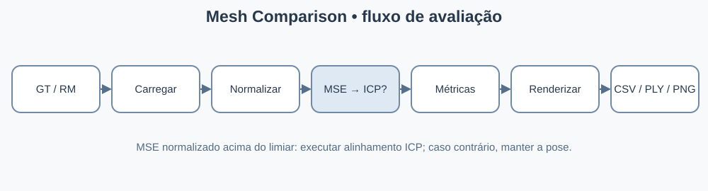

# 09 — Exportar resultados e verificar a execução

> **Objetivo:** implementar esta parte desde o zero, mesmo que ela já exista nos scripts de referência.



## Passo 1 — O que criar

Depois de calcular as métricas, monte uma linha de resultados geométricos e grave `output/metrics/mesh_metrics.csv`. Para o fluxo perceptual, grave uma linha por vista em `per_view_metrics.csv` e estatísticas de mínimo, máximo, percentis 25/75, mediana e média em `metric_summary.csv`. Salve também `run_metadata.csv`.

## Passo 2 — Implementação inicial

```python
# Exporta métricas e devolve a malha alinhada à unidade de entrada
import pandas as pd

pd.DataFrame([{
    'chamfer_mean_normalized': metrics['chamfer_mean'],
    'hausdorff_normalized': metrics['hausdorff'],
    'rmse_normalized': metrics['rmse'],
}]).to_csv('output/metrics/mesh_metrics.csv', index=False)
rm_export = rm_aligned.copy()
rm_export.apply_scale(diagonal_gt)
rm_export.export('output/aligned/rm_aligned.ply')
```

## Passo 3 — Completar, executar e validar

No código final, crie previamente os diretórios, inclua os demais campos e multiplique distâncias normalizadas por `diagonal_gt` para recuperar unidades GT; MSE deve ser multiplicado por `diagonal_gt²`. Execute os dois scripts separadamente e confira os CSVs e PNGs. Atenção: ambos gravam `rm_aligned.ply` no mesmo caminho e podem sobrescrevê-lo.

## Passo 4 — Próxima etapa

Continue para [10 — Validar os limites antes de ampliar o projeto](10-limitacoes-evolucao.md).

**Código de referência:** [pipeline geométrico](../mesh_eval_pipeline.py) e [pipeline perceptual](../percept_eval_pipeline.py). As amostras acima mostram etapas de construção; consulte as funções completas nos scripts quando houver utilitários auxiliares.
