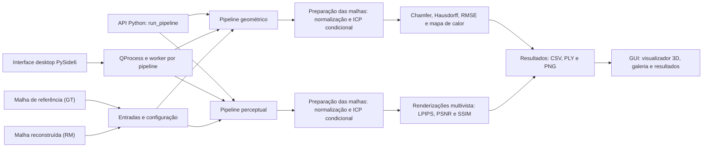

# Documentação — Mesh Comparison

Esta é a navegação da documentação para a versão atual do projeto, organizado como pacote Python em `src/meshcomparison/`. Os exemplos de resultados são um registro histórico; mudanças na estrutura do projeto não equivalem a uma nova execução validada. A pasta [`archived/`](archived/README-v1.md) guarda READMEs de versões anteriores e não deve ser usada como instrução de instalação ou execução.

| Área | Conteúdo | Quando consultar |
| --- | --- | --- |
| [Avaliação de malhas 3D](https://github.com/lianeheidemann/mesh-comparison-article/tree/main/avaliacao-geometrica) | Conceitos, métricas geométricas e perceptuais, aplicações e limitações (movido para o repositório privado `mesh-comparison-article`) | Antes de interpretar métricas |
| [Implementação e evolução](implementation/README.md) | Testes existentes, lacunas de validação e plano de evolução | Ao estudar ou alterar o código |
| [Interface desktop](../README.md#run) | Instalação, execução e validação da GUI PySide6/PyVistaQt (seções do README principal) | Para inspecionar GT, RM, heatmap e relatórios |
| [Resultados de exemplo](results/README.md) | Métricas e imagens de uma execução previamente registrada | Para consultar um conjunto específico de resultados |
| [Referências e chamadas](https://github.com/lianeheidemann/mesh-comparison-article) | Movidas para o repositório privado `mesh-comparison-article` (`references/` e `conferences/`) | Para consultar fontes e oportunidades de publicação |
| [Agent Harness](harness/README.md) | Estado do desenvolvimento assistido por agentes, guardrails e roteiro reutilizável | Para organizar futuras implementações via LLM |
| [Referências sobre Harness](harness/REFERENCIAS.md) | Fontes oficiais e materiais complementares | Para fundamentar decisões e arquitetura |

## Arquitetura atual



Na GUI, os pipelines selecionados são executados em processos filhos sequencialmente; a API Python chama os mesmos módulos diretamente. A estrutura dos módulos está resumida abaixo; o [guia de implementação](implementation/README.md) registra testes e validação pendente, e a seção [Validate on Windows](../README.md#validate-on-windows) do README principal descreve como operar a interface.

## Entrada rápida para a versão atual

O pacote em `src/meshcomparison/` está dividido em:

- **`common/`** — carregamento de malhas, preparo compartilhado em `prepare.py` (normalização, MSE, ICP e exportação), transformações, distâncias, renderização e escolha do dispositivo para LPIPS.
- **`geometry/`** — métricas geométricas, heatmap e pipeline.
- **`perceptual/`** — câmeras, imagens, LPIPS/PSNR/SSIM e pipeline multivista.
- **`gui/`** — interface Qt com módulos separados para janela, painéis, configuração, supervisão (`runner.py`), processo filho (`worker.py`), carregamento das saídas e visualizador PyVistaQt.

Depois de preparar `meshEval` e instalar o pacote em modo editável, abra a interface para executar as avaliações:

```bash
python -m meshcomparison.gui
```

O comando inicia uma **janela desktop** e requer PySide6, PyVista, PyVistaQt e um ambiente com interface gráfica. Veja a [instalação](../README.md#installation) no README principal. O CI atual executa `ruff check .`, `pytest -q` e uma verificação de importação dos pipelines e do worker. Alguns testes rodam os pipelines em subprocesso com configuração reduzida, apenas para verificar a estrutura das saídas; o CI não testa a janela interativa, não valida valores científicos nem a configuração padrão de 100 vistas.

**Convenção de status:** “implementado no código” não significa “validado em todos os ambientes”. Recursos de GUI, GPU e renderização gráfica precisam de testes próprios antes de se declarar suporte comprovado.

**Para validar no Windows:** siga a seção [Validate on Windows](../README.md#validate-on-windows) do README inicial para CUDA/PyTorch, `mesh-gui` e comparação dos CSVs dos dois pipelines. Use uma nova pasta de saída para cada experimento: os dois pipelines gravam na pasta escolhida e ambos exportam o mesmo `aligned/rm_aligned.ply`.
