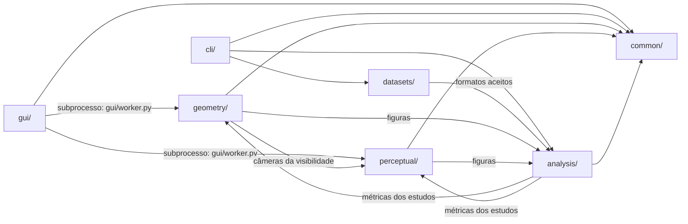

# Documentação — Mesh Comparison

| Documento | Conteúdo |
| --- | --- |
| [README principal](../README.md) | Visão geral, métricas, instalação, uso, saídas e limitações |
| [ADRs](adr/) | Decisões sobre as métricas: [0001](adr/0001-evaluation-v2.md) amostras de superfície · [0002](adr/0002-robustness-study.md) NC, F(τ) e estudo de robustez · [0003](adr/0003-single-metric-standard.md) padrão único · [0004](adr/0004-point-to-surface.md) ponto-superfície · [0005](adr/0005-icp-global-start.md) ICP com início global |
| [Implementação e validação](implementation/README.md) | Testes existentes e validação pendente |
| [Escolha das GTs](gt/README.md) | Como escolher e limpar malhas de referência sem contaminação do treino; manifesto e verificador |
| [Resultados de exemplo](results/README.md) | Métricas e gráficos do par de exemplo |
| [Estudo de robustez](results/robustness/README.md) | Invariância à triangulação e sensibilidade das métricas; roteiro do artigo |
| [Validação do ICP](results/icp/README.md) | Recuperação de rotação, escala e translação conhecidas, antes e depois da inicialização global |
| [Agent Harness](harness/README.md) | Desenvolvimento assistido por agentes: estado, fluxo e referências |
| [Artigo e referências](https://github.com/lianeheidemann/mesh-comparison-article) | Repositório privado `mesh-comparison-article` |

## Arquitetura

Visão geral do fluxo no [diagrama do README](../README.md#user-content-how-it-works). Abaixo, quem importa quem entre os pacotes (seta = "usa"); `common/` não depende de nenhum outro:

As setas entre `analysis/` e os pipelines ligam módulos diferentes (`plots.py` não importa os pipelines; `robustness.py` importa as métricas), então não há importação circular.

## Módulos (`src/meshcomparison/`)

| Pacote | Responsabilidade | Arquivos |
| --- | --- | --- |
| `common/` | Base compartilhada: leitura de malhas e cenas (só triângulos), amostragem, distâncias, preparo e ICP, renderização, dispositivo | `io.py`, `sampling.py`, `distances.py`, `alignment.py`, `prepare.py` |
| `geometry/` | Pipeline geométrico: métricas, regiões visível/oculta, heatmap | `metrics.py`, `visibility.py`, `heatmap.py`, `pipeline.py` |
| `perceptual/` | Pipeline perceptual: câmeras, máscaras e crop, LPIPS/PSNR/SSIM | `cameras.py`, `image_metrics.py`, `pipeline.py` |
| `analysis/` | Verificação das GTs, estudos de robustez e do ICP, gráficos | `gt_check.py`, `robustness.py`, `plots.py` |
| `datasets/` | Manifesto das GTs e download do Google Scanned Objects | `manifest.py`, `gso.py` |
| `cli/` | Uma linha de comando fina por ferramenta (`mesh-*`) | `check_gt.py`, `fetch_gso.py`, `plot_metrics.py`, `robustness_study.py`, `icp_study.py` |
| `gui/` | Janela, painéis e execução em subprocesso; abas de resultados; visualizador 3D | `main_window.py`, `runner.py`, `results_view.py`, `result_tables.py`, `image_gallery.py`, `viewer3d.py`, `view_geometry.py` |

Cada ferramenta de `cli/` é instalada como comando `mesh-*` (`mesh-check-gt`, `mesh-fetch-gso`, `mesh-plot-metrics`, `mesh-robustness-study`, `mesh-icp-study`) e também roda como `python scripts/<nome>.py`, um atalho de poucas linhas. Ferramentas: `fetch_gso.py` (baixa a seleção do GSO e escreve o manifesto), `check_gt.py` (verificação das GTs), `plot_metrics.py` (regenera as figuras de uma execução; `--uncertainty` acrescenta a dispersão de amostragem), `robustness_study.py` (estudo de robustez) e `icp_study.py` (validação do ICP).
