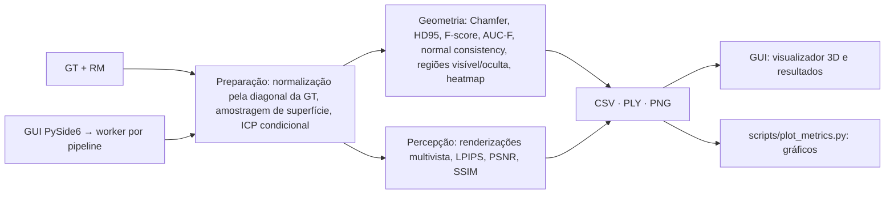

# Documentação — Mesh Comparison

| Documento | Conteúdo |
| --- | --- |
| [README principal](../README.md) | Visão geral, métricas, instalação, uso, saídas e limitações |
| [ADRs](adr/) | Definição e justificativa das métricas: [0001](adr/0001-evaluation-v2.md) amostras de superfície, [0002](adr/0002-robustness-study.md) normal consistency, F(τ) e estudo de robustez, [0003](adr/0003-single-metric-standard.md) padrão único, [0004](adr/0004-point-to-surface.md) distâncias ponto-superfície |
| [Implementação e validação](implementation/README.md) | Testes existentes e validação pendente |
| [Resultados de exemplo](results/README.md) | Métricas e gráficos do par de exemplo |
| [Estudo de robustez](results/robustness/README.md) | Invariância à triangulação e sensibilidade das métricas; roteiro do artigo |
| [Agent Harness](harness/README.md) | Desenvolvimento assistido por agentes: estado, fluxo e referências |
| [Artigo e referências](https://github.com/lianeheidemann/mesh-comparison-article) | Repositório privado `mesh-comparison-article` |

## Arquitetura

## Módulos (`src/meshcomparison/`)

| Pacote | Responsabilidade |
| --- | --- |
| `common/` | Leitura de malhas, amostragem de superfície (`sampling.py`), distâncias (`distances.py`: KD-tree e ponto-superfície via Open3D), preparo compartilhado (`prepare.py`: normalização, MSE ponto-superfície, ICP sobre amostras, exportação), transformações, renderização, dispositivo do LPIPS |
| `geometry/` | Métricas (`metrics.py`), visibilidade pela vista de entrada (`visibility.py`), heatmap, renderização e pipeline |
| `perceptual/` | Câmeras, máscaras e crop, LPIPS/PSNR/SSIM e pipeline multivista |
| `analysis/` | Estudo de robustez (`robustness.py`: perturbações, baseline por vértice, dispersão de amostragem) e gráficos (`plots.py`) |
| `gui/` | Janela, painéis, configuração (`RunConfig`), execução em subprocesso, leitura das saídas e visualizador PyVistaQt |

Scripts em `scripts/`: `plot_metrics.py` (gráficos de uma execução) e `robustness_study.py` (estudo de robustez).
