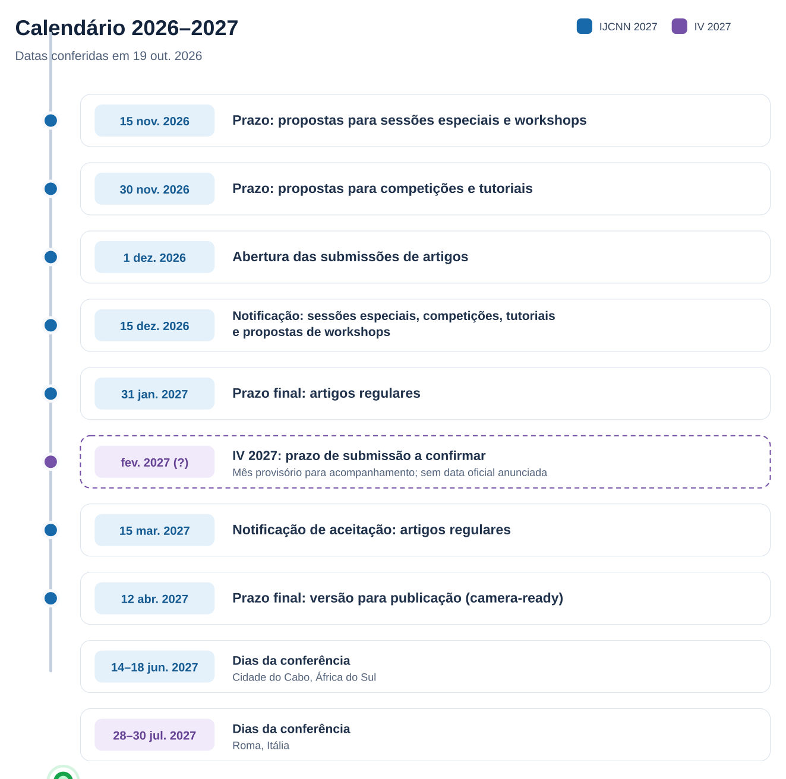

# Referências

Este diretório guarda documentos de pesquisa consultados como material de apoio. As referências aqui listadas contextualizam o trabalho; não são documentação da implementação nem evidência de validação dos pipelines deste repositório.

## Referência bibliográfica

[1] R. Fan, U. Ozgunalp, B. Hosking, M. Liu, and I. Pitas, “Pothole Detection Based on Disparity Transformation and Road Surface Modeling,” *IEEE Transactions on Image Processing*, vol. 29, pp. 897–908, 2020, doi: 10.1109/TIP.2019.2933750 • Arquivo: [PDF](pdf/01-Pothole-Detection-Based-on-Disparity.pdf).

[2] J. McEwen, “A Brief Introduction to Geometric Deep Learning,” *Towards Data Science*, Medium, Jul. 25, 2022. [Online]. Available: [https://medium.com/data-science/a-brief-introduction-to-geometric-deep-learning-dae114923ddb](https://medium.com/data-science/a-brief-introduction-to-geometric-deep-learning-dae114923ddb). Accessed: Oct. 19, 2026  • Arquivo: [PDF](pdf/02-A-Brief-Introduction-to-Geometric-Deep-Learning.pdf).

[3] R. Zhang, P. Isola, A. A. Efros, E. Shechtman, and O. Wang, “The Unreasonable Effectiveness of Deep Features as a Perceptual Metric,” in *Proceedings of the IEEE Conference on Computer Vision and Pattern Recognition (CVPR)*, 2018, pp. 586–595. [Online]. Available: [https://openaccess.thecvf.com/content_cvpr_2018/html/Zhang_The_Unreasonable_Effectiveness_CVPR_2018_paper.html](https://openaccess.thecvf.com/content_cvpr_2018/html/Zhang_The_Unreasonable_Effectiveness_CVPR_2018_paper.html)  • Arquivo: [PDF](pdf/03-The-Unreasonable-Effectiveness-of-Deep-Features-as-a-Perceptual-Metric.pdf).

## Conferências e chamadas de trabalhos

- **IJCNN 2027:** [chamada de trabalhos](https://ijcnn.org/2027/authors/call-for-papers). A página informa que artigos completos devem ter até seis páginas no formato IEEE de duas colunas.
- **IV 2027:** [site oficial](https://iv.csites.fct.unl.pt/). Na edição de 2026, o prazo de submissão foi 30 de março. Para 2027, ainda não há data oficial. Fevereiro de 2027 consta no calendário apenas como lembrete para acompanhar a divulgação do *Call for Papers*.
