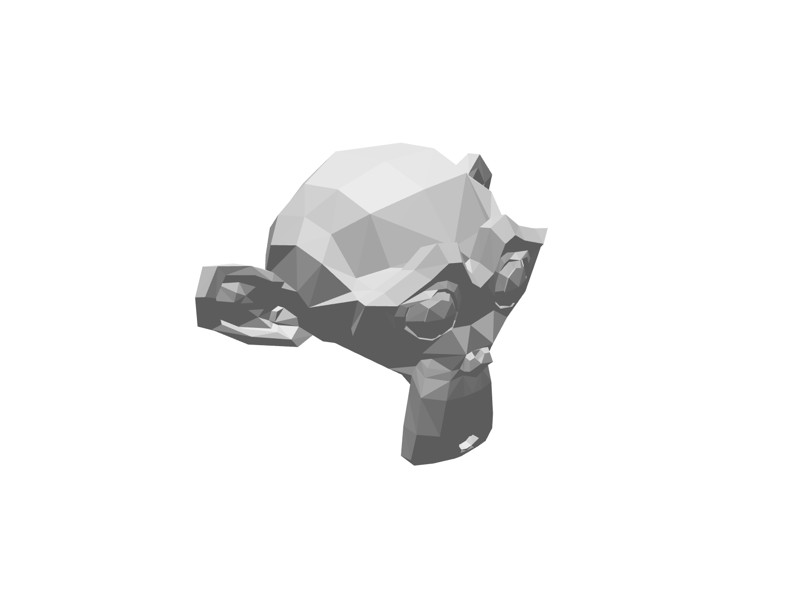
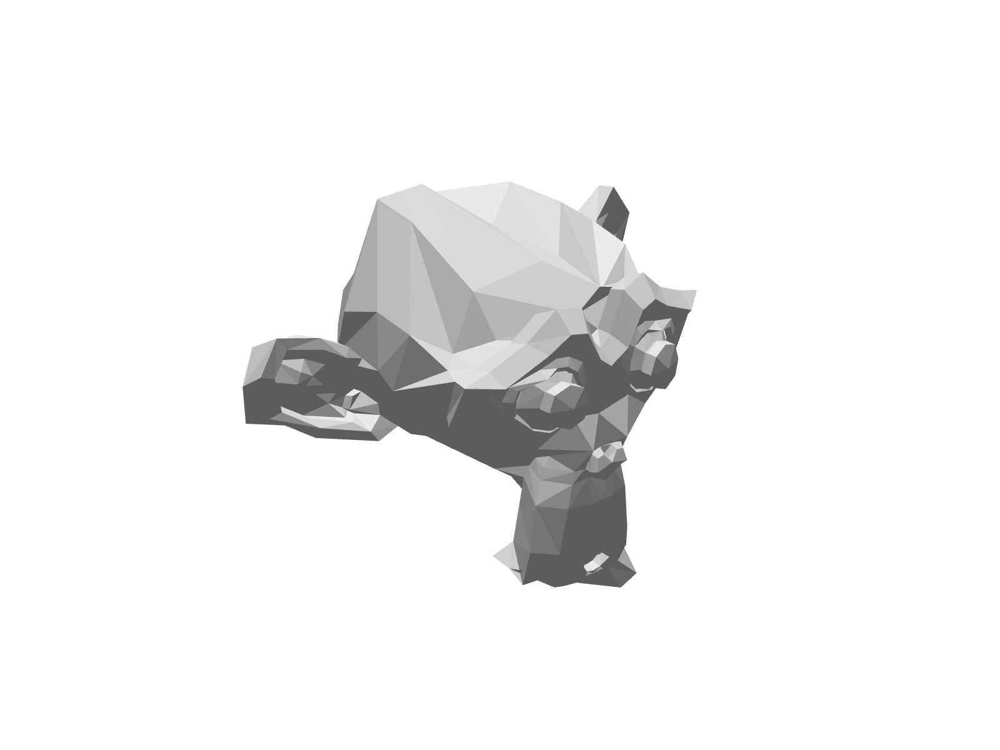
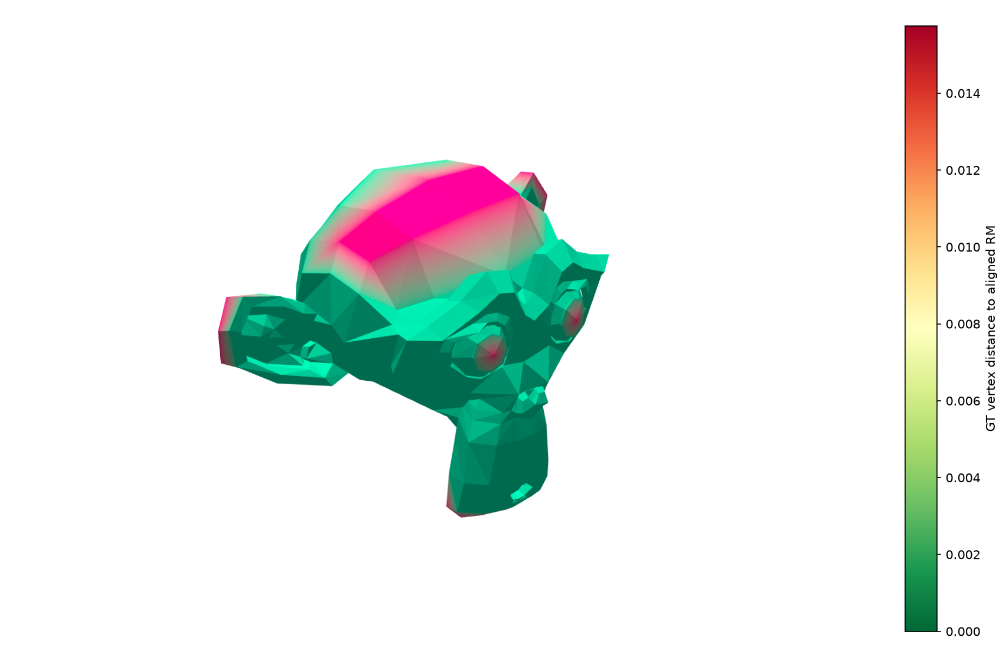
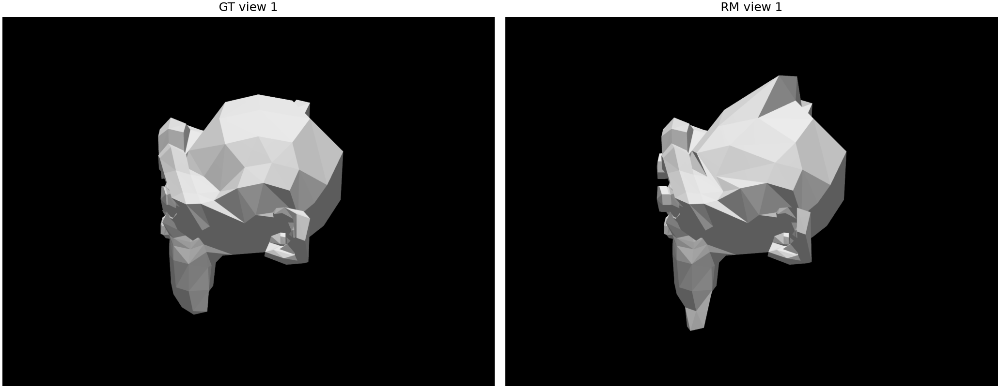

<p align="center">
  
</p>

> **Archived documentation:** this snapshot predates the current modular package and desktop interface. Its installation commands, file layout, and pipeline entry points are historical; use the [current project README](../../README.md) and [documentation index](../README.md) for current instructions.

<h1 align="center">Mesh Comparison: Mesh Evaluation</h1>

<p align="center">
  <a href="https://github.com/lianeheidemann/mesh-comparison/actions/workflows/ci.yml">
    
  </a>
</p>

<p align="center">
  <picture><source media="(prefers-color-scheme: dark)" srcset="https://img.shields.io/badge/Python-3B4A5A?style=flat-square&logo=python&logoColor=white"></picture>
  <picture><source media="(prefers-color-scheme: dark)" srcset="https://img.shields.io/badge/NumPy-3B4A5A?style=flat-square&logo=numpy&logoColor=white"></picture>
  <picture><source media="(prefers-color-scheme: dark)" srcset="https://img.shields.io/badge/Trimesh-3B4A5A?style=flat-square"></picture>
  <picture><source media="(prefers-color-scheme: dark)" srcset="https://img.shields.io/badge/Open3D-3B4A5A?style=flat-square"></picture>
  <picture><source media="(prefers-color-scheme: dark)" srcset="https://img.shields.io/badge/PyTorch-3B4A5A?style=flat-square&logo=pytorch&logoColor=white"></picture>
  <picture><source media="(prefers-color-scheme: dark)" srcset="https://img.shields.io/badge/LPIPS-3B4A5A?style=flat-square"></picture>
</p>

This workspace compares a ground-truth mesh with a reconstructed mesh. Convert FBX models to STL (or another supported `trimesh` format) before running the evaluation scripts; they do not load FBX directly.

---


## Technologies

| Technology | Installed version (reported 2026-10-17) | Role in the project |
| --- | --- | --- |
| Python | 3.12.15 | Main language for both evaluation pipelines. |
| Conda | 25.11.1 (Windows win-64) | Isolated Python environment and dependency management. |
| NumPy | 2.5.4 | Numerical operations on coordinates, arrays, and distances. |
| Trimesh | 5.1.1 | Loading, inspecting, transforming, and exporting 3D meshes. |
| Open3D | 0.20.0 | Iterative Closest Point (ICP) mesh alignment. |
| SciPy (cKDTree) | 1.18.1 | Efficient nearest-neighbor searches for geometric metrics. |
| pyrender | 0.1.45 | Offscreen rendering of meshes for image-based comparison. |
| Matplotlib | 3.11.2 | Geometric distance visualization and heatmap color mapping. |
| imageio | 2.38.1 | Writing rendered images to disk. |
| PyTorch | 2.14.1 | Neural-network execution for perceptual evaluation, with optional CUDA acceleration. |
| torchvision | 0.29.1 | Vision models and utilities used by LPIPS. |
| LPIPS | 0.1.4 | Learned perceptual similarity between rendered views. |
| scikit-image | 0.26.0 | Structural Similarity Index (SSIM) calculation. |
| pandas | 3.0.6 | Tabular metrics, summaries, and CSV exports. |

These versions were reported from the local Windows `meshEval` environment on 2026-10-17. Imports and both example pipelines were confirmed in that environment. PyTorch reports `2.14.1+cpu`; CUDA is unavailable, so perceptual evaluation runs on CPU. [`environment-lock.yml`](../../environments/environment-lock.yml) records the Python and pip package pins from this Windows snapshot; it does not pin the Conda executable version. [`environment.yml`](../../environments/environment.yml) remains the general, unpinned dependency list. These observed versions do not identify the environment that produced older outputs already in the repository. The installer’s base Python version is independent of the project environment.

## Workspace layout

```text
MeshComparison/
├── gt.stl                         # Ground-truth mesh
├── mod.stl                        # Reconstructed/model mesh
├── mesh_eval_pipeline.py          # Geometric mesh comparison
├── percept_eval_pipeline.py       # Multi-view perceptual comparison
├── run_mesh_eval.bat              # Windows launcher for geometric evaluation
├── run_percept_eval.bat           # Windows launcher for perceptual evaluation
└── output/
    ├── aligned/                   # Aligned reconstructed mesh exports
    ├── heatmaps/                  # Geometric distance heatmap assets
    ├── metrics/                   # CSV metric reports
    └── renders/                   # Mesh and view renders
        ├── gt/
        ├── pairs/
        └── rm/
```

The launchers use `gt.stl` as the ground truth and `mod.stl` as the reconstructed mesh, and write results under `output/`. Runs may replace files with the same names in those output folders.

## Requirements

Use Python in a Conda environment named `meshEval` to run the supplied `.bat` files. The scripts import NumPy, pandas, trimesh, pyrender, Open3D, Matplotlib, imageio, and SciPy. The perceptual pipeline additionally imports scikit-image, PyTorch, and LPIPS. A working offscreen-rendering setup is needed for `pyrender`; the perceptual pipeline uses CUDA when available and otherwise runs LPIPS on CPU.

## Installation

Run each step separately in Anaconda Prompt, from the repository root.

```bat
conda env create -f environment.yml
conda activate meshEval
```

The general environment file creates `meshEval` with Python 3.12 and installs the dependencies with pip. These unpinned dependencies may resolve to different versions over time. To recreate the recorded Windows environment with its package versions, use the snapshot instead:

```bat
conda env create -f environment-lock.yml
```

If `meshEval` already exists, activate it instead of creating it again. The environment preparation guide that recorded the validation details has been removed; see the [current README](../../README.md#user-content-installation). Verify imports before running the pipelines:

```bat
python -c "import numpy, pandas, trimesh, pyrender, open3d, matplotlib, imageio, scipy, skimage, torch, torchvision, lpips; print('OK: libraries loaded')"
```

The local validation used CPU-only PyTorch. For GPU-accelerated LPIPS, install a PyTorch build that matches your CUDA version using the official PyTorch installation instructions.

## Run

From this folder in Windows, double-click either batch file or run it in a Command Prompt:

```bat
run_mesh_eval.bat
run_percept_eval.bat
```

To choose other input or output paths, call Python directly:

```bat
python mesh_eval_pipeline.py --gt gt.stl --rm mod.stl --out output
python percept_eval_pipeline.py --gt gt.stl --rm mod.stl --out output
```

Both scripts require `--gt` and `--rm`; `--out` defaults to `output`.

## Pipelines

### Geometric evaluation

`mesh_eval_pipeline.py` normalizes both meshes using the ground-truth bounding-box diagonal. It measures symmetric nearest-vertex distances, and runs similarity ICP (rotation, translation, and uniform scale) when the pre-alignment normalized MSE exceeds the configured threshold. It writes one shared-view render per mesh and a ground-truth vertex-distance heatmap.

Main outputs:

- `output/metrics/metrics_geometry.csv`: pre/post-alignment MSE, mean Chamfer distance, symmetric Hausdorff distance, symmetric RMSE, alignment status, and transform metadata. Distance metrics are reported both normalized and in the original ground-truth units.
- `output/aligned/rm_aligned.ply`: aligned reconstructed mesh, exported in the input ground-truth scale.
- `output/renders/gt_ortho.png` and `output/renders/rm_aligned_ortho.png`: orthographic renders.
- `output/heatmaps/gt_heatmap_ortho.png`: rendered distance heatmap; `gt_heatmap_colored.ply` is the colored mesh used to create it.

### Perceptual evaluation

`percept_eval_pipeline.py` uses the same normalization and conditional ICP alignment, then renders the meshes across a rotating set of camera azimuths. It computes masked LPIPS, PSNR, and SSIM per view and summarizes their distributions. By default, it evaluates 100 views and saves views 1, 33, and 66.

Main outputs:

- `output/metrics/per_view_metrics.csv`: one row per view with LPIPS, PSNR, SSIM, camera angle, and framing values.
- `output/metrics/metrics_perceptual.csv`: min, max, 25th/75th percentiles, median, and mean for each perceptual metric.
- `output/metrics/run_metadata.csv`: input paths, alignment details, view settings, and the final transform.
- `output/aligned/rm_aligned.ply`: aligned reconstructed mesh in the ground-truth input scale.
- `output/renders/gt/`, `output/renders/rm/`, and `output/renders/pairs/`: saved images for the selected views.

## Example results

The images below are sample outputs from the geometric and perceptual pipelines.

<table>
  <tr>
    <td width="50%" align="center">
      <strong>Ground-truth mesh (GT)</strong><br>
      
    </td>
    <td width="50%" align="center">
      <strong>Aligned reconstructed mesh (RM)</strong><br>
      
    </td>
  </tr>
  <tr>
    <td colspan="2" align="center">
      <strong>Geometric distance heatmap</strong><br>
      
    </td>
  </tr>
  <tr>
    <td colspan="2" align="center">
      <strong>Perceptual comparison — view 1</strong><br>
      
    </td>
  </tr>
</table>

See the [full example report](../results/README.md) for the metrics and additional views.

## Options

Both scripts accept `--mse-threshold` (default `1e-4`), which controls whether alignment is run, plus `--width` and `--height` (defaults `1600` and `1200`). Use `--help` after the script name to see all options.

The geometric pipeline also accepts `--azimuth` (default `-135`) and `--elevation` (default `25.264`). The perceptual pipeline accepts `--elevation` (default `25.264`), `--num-views` (default `100`), `--save-views` (default `1 33 66`), `--camera-margin` (default `1.05`), and `--radius-factor` (default `1.45`).

## Development

`environment.yml` also installs `pytest` and `ruff`. From the activated environment:

```bat
ruff check .
pytest
```

GitHub Actions (`.github/workflows/ci.yml`) runs lint, the tests, and the `--help` of both scripts. It does not run the rendering or CUDA parts of the pipelines.

## License and credits

This repository is a fork of [ThiagoFigueiroRibeiro/MeshComparison](https://github.com/ThiagoFigueiroRibeiro/MeshComparison). The modifications in this fork are proprietary; see [LICENSE](../../LICENSE). Code derived from the original project remains the property of its author.

See the [current example results](../results/README.md) for the recorded geometric and perceptual metrics and their output images.
