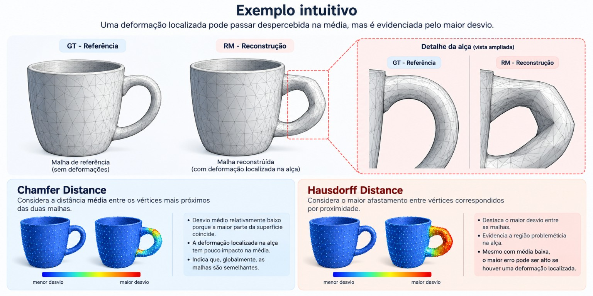
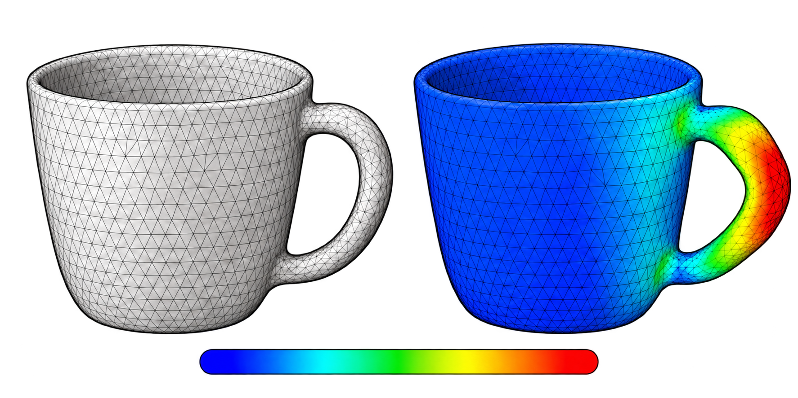
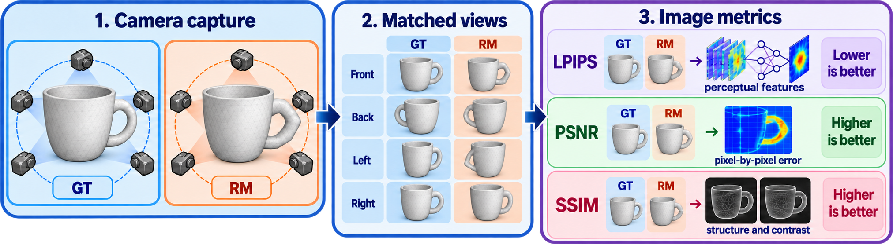
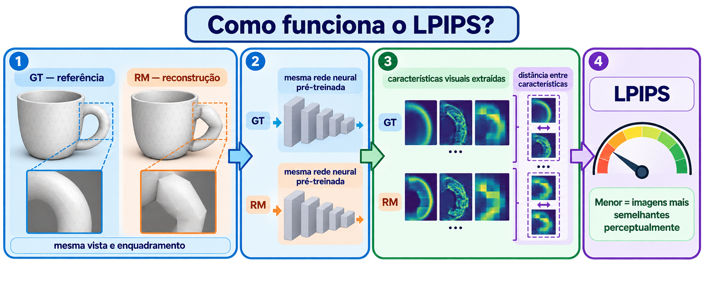
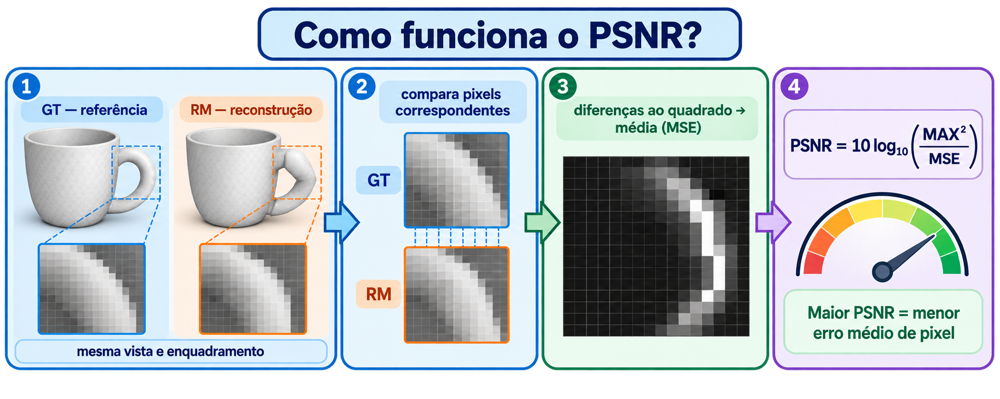
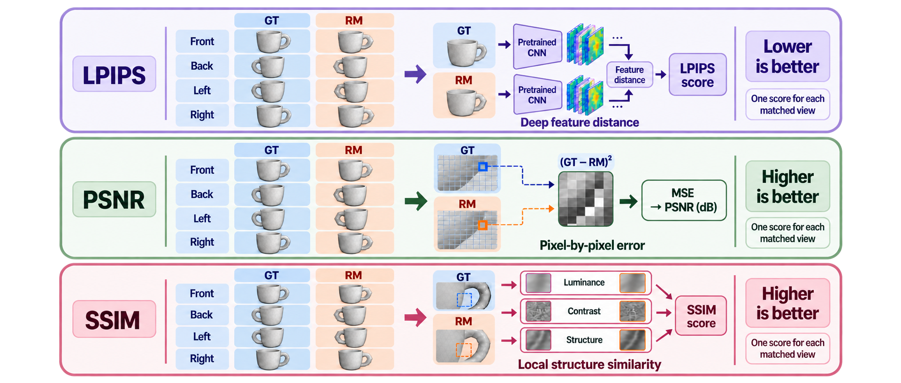

# Como avaliar a qualidade de uma malha 3D

Este guia explica **o que o Mesh Comparison procura medir**, por que diferentes avaliações são necessárias e como interpretar os resultados. Não é um tutorial de programação. Para construir os pipelines, consulte o [tutorial de implementação](../implementation/README.md).

## 1. O que estamos comparando?

Uma **malha 3D (mesh)** representa a superfície de um objeto usando pontos (**vértices**) conectados em faces, geralmente triângulos. O projeto compara dois modelos:

- **GT (Ground Truth):** modelo de referência, considerado a representação desejada.
- **RM (Reconstructed Mesh):** modelo reconstruído ou gerado, cuja fidelidade queremos investigar.

A pergunta central não é simplesmente “os arquivos são iguais?”, mas **“quanto o objeto reconstruído se aproxima do objeto de referência, em forma e aparência?”**

## 2. Antes de medir: uma comparação justa

Imagine duas cópias idênticas de uma xícara: uma foi deslocada para a direita. Se compararmos diretamente suas posições, parecerão muito diferentes, mesmo tendo a mesma forma.

Por isso, o projeto primeiro **normaliza** os modelos usando uma escala comum baseada no tamanho da GT (*Ground Truth*, ou malha de referência). Depois, pode executar o **ICP** (*Iterative Closest Point*, algoritmo iterativo dos pontos mais próximos), um procedimento que tenta alinhar as malhas por rotação, translação e, nesta implementação, escala uniforme.

**Por que importa?** O alinhamento ajuda a separar diferenças de posicionamento das diferenças de geometria. Entretanto, permitir mudança de escala também pode esconder um erro dimensional real. É importante observar as métricas antes e depois do alinhamento.

## 3. Avaliação geométrica: a forma é parecida?

Essa avaliação observa a posição dos vértices no espaço. Para cada vértice de uma malha, procura-se o vértice mais próximo na outra; a comparação é feita nos dois sentidos.

| Métrica | Pergunta que responde | Como interpretar |
| --- | --- | --- |
| **MSE** (erro quadrático médio) | Qual é o erro geométrico médio, dando mais peso aos desvios grandes? | **Menor é melhor.** O valor está em unidades de distância ao quadrado. |
| **RMSE** (raiz do erro quadrático médio) | Qual é a magnitude típica dos desvios, penalizando erros maiores? | **Menor é melhor.** Tem unidade de distância, facilitando a leitura. |
| **Chamfer Distance** | Em média, quão próximos estão os vértices das duas malhas? | **Menor é melhor.** Resume o desvio geral da forma. |
| **Hausdorff Distance** | Qual é o maior afastamento encontrado entre vértices correspondidos por proximidade? | **Menor é melhor.** Evidencia regiões muito discrepantes. |

### Exemplo intuitivo

Suponha que uma reconstrução de uma xícara esteja quase perfeita, mas tenha uma alça muito deformada. A **Chamfer** pode continuar relativamente baixa porque a maior parte da superfície é parecida. A **Hausdorff** tende a destacar o maior erro, revelando que há uma região problemática.

**Atenção:** no projeto atual, essas medidas usam **vértices mais próximos**, não a distância exata entre superfícies triangulares. Malhas com densidades ou distribuições de vértices muito diferentes podem produzir resultados influenciados pela discretização.

## 4. Mapas de calor: onde está o erro?

Um número resume o resultado, mas não mostra **onde** a reconstrução falhou. O *heatmap* colore regiões da malha conforme a distância até a referência, ajudando a localizar deformações, partes ausentes ou diferenças concentradas.

Ele complementa as métricas: duas malhas podem ter valores médios semelhantes e distribuições de erro completamente diferentes. A interpretação das cores depende da escala utilizada na visualização.

  

## 5. Avaliação perceptual: os modelos parecem iguais?

Duas malhas podem apresentar diferenças geométricas pequenas, mas gerar imagens visualmente diferentes — por exemplo, no contorno ou em detalhes visíveis. O projeto gera imagens da GT (malha de referência) e da RM (malha reconstruída) usando **a mesma câmera** em diferentes ângulos e compara os resultados.

| Métrica | O que observa | Melhor resultado |
| --- | --- | --- |
| **LPIPS** | Diferenças em características visuais extraídas por uma rede neural pré-treinada. | **Menor**: imagens mais semelhantes perceptualmente. |
| **PSNR** | Intensidade das diferenças entre pixels, expressa em decibéis. | **Maior**: imagens mais próximas em termos de erro de pixel. |
| **SSIM** | Semelhança de estrutura, contraste e luminância das imagens. | **Maior**: maior semelhança estrutural; normalmente próximo de 1 para imagens muito similares. |

#### Como funciona o LPIPS?

Para cada ângulo, o LPIPS envia as renderizações correspondentes da GT e da RM pela mesma rede neural pré-treinada. A rede extrai características visuais em diferentes camadas, e a métrica calcula a distância entre essas representações. **Um valor menor indica imagens mais semelhantes perceptualmente.** O LPIPS compara características visuais aprendidas; não mede diretamente distâncias entre vértices da malha.

  

**Referências:** [artigo original do LPIPS (CVPR 2018)](https://openaccess.thecvf.com/content_cvpr_2018/html/Zhang_The_Unreasonable_Effectiveness_CVPR_2018_paper.html) e [visão geral de métricas de qualidade de imagem no MATLAB](https://www.mathworks.com/help/images/image-quality-metrics.html). A documentação do MATLAB apresenta MSE, PSNR e SSIM nessa página, mas não documenta LPIPS como função nativa.

#### Como funciona o PSNR?

Para cada ângulo, o PSNR compara as renderizações correspondentes da GT e da RM com o mesmo enquadramento. Ele calcula as diferenças entre pixels, eleva cada diferença ao quadrado e tira a média (MSE). Em seguida, converte o MSE para decibéis: PSNR = 10 log10(MAX² / MSE), em que MAX é o maior valor possível de pixel. **Quanto maior o PSNR, menor o erro médio entre as imagens.**

  

A métrica avalia as imagens renderizadas, não as distâncias entre vértices da malha.

**Documentação MATLAB:** [função psnr](https://www.mathworks.com/help/images/ref/psnr.html) e [bloco PSNR no Simulink](https://www.mathworks.com/help/vision/ref/psnr.html).

### Por que usar vários ângulos?

Uma deformação pode ficar invisível quando vista de frente, mas evidente de lado. A avaliação multivista reduz a dependência de uma única perspectiva. No pipeline perceptual, são usadas **100 vistas por padrão**; a quantidade pode ser configurada.

**Limitação importante:** as métricas perceptuais avaliam **renderizações**, não a geometria diretamente. Iluminação, enquadramento, máscaras e configuração da câmera influenciam os resultados. Além disso, o PSNR implementado no projeto tem uma convenção própria de agregação dos canais RGB, que deve ser considerada ao comparar valores com outras ferramentas.

## 6. Qual avaliação é mais relevante?

Depende do objetivo:

| Objetivo | Avaliações mais úteis | Por quê |
| --- | --- | --- |
| Conferir fidelidade da forma reconstruída | Chamfer, RMSE e Hausdorff | Medem desvios geométricos gerais e extremos. |
| Identificar uma parte deformada ou ausente | Hausdorff e heatmap | Evidenciam erros localizados. |
| Comparar a aparência do objeto em imagens | LPIPS, SSIM e PSNR | Avaliam semelhança das renderizações. |
| Avaliar consistência ao redor de todo o objeto | Métricas perceptuais multivista | Revelam diferenças que aparecem somente em certos ângulos. |
| Investigar efeito do posicionamento | MSE antes/depois do ICP e transformação | Ajuda a distinguir pose de diferenças de forma. |

**Nenhuma métrica, isoladamente, determina a “qualidade total” de uma malha.** Uma malha pode ser visualmente parecida e ainda conter problemas de topologia, faces invertidas, partes desconectadas ou geometria inadequada para impressão 3D. Esses aspectos não são auditados de forma abrangente pelos pipelines atuais.

## 7. Como ler os resultados em conjunto

1. **Confira o alinhamento:** a comparação foi feita entre modelos na mesma pose? Houve mudança de escala?
2. **Observe o erro médio:** Chamfer e RMSE sugerem quão próxima é a geometria em geral.
3. **Procure os extremos:** Hausdorff e heatmap ajudam a encontrar falhas concentradas.
4. **Compare a aparência:** LPIPS, PSNR e SSIM mostram se as diferenças são perceptíveis nas renderizações.
5. **Considere o uso final:** uma pequena deformação pode ser aceitável em uma visualização, mas crítica em uma peça de encaixe ou fabricação.

### Conclusão

O Mesh Comparison combina **medidas geométricas** (diferenças na forma) e **medidas perceptuais** (diferenças na aparência renderizada). Essa combinação fornece uma avaliação mais informativa do que uma única pontuação, desde que os resultados sejam interpretados junto com suas limitações.
