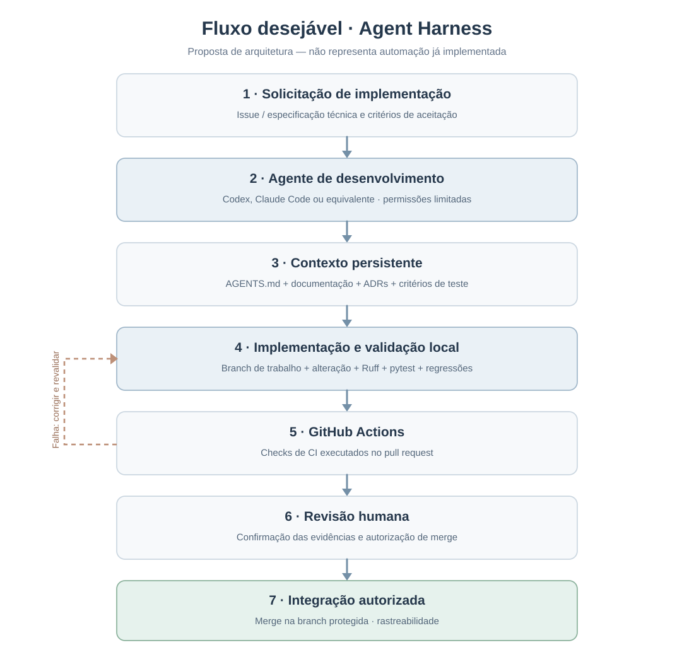

# Agent Harness — Mesh Comparison

> **Estado:** documentação e plano de evolução; **não** significa que um harness autônomo completo esteja implementado.
>
> **Escopo:** inventário inicial realizado na `main` em **18/10/2026**, atualizado na branch `single-view-3d-reconstruction` em 19/10/2026 (pacote `src/meshcomparison/`, pipelines científicos acionados pela interface gráfica PySide6/PyVista). Os status refletem arquivos e configurações; execução de testes e proteção remota precisam ser comprovadas.

## 1. O que é *harness*?

Um **agent harness** é o conjunto de mecanismos ao redor de um modelo de linguagem que lhe permite executar tarefas de desenvolvimento de forma controlada: instruções e contexto, ferramentas e permissões, ambiente reproduzível, critérios de aceitação, execução de testes, revisão, observabilidade e ciclos de feedback. O modelo **não** se confunde com esse ambiente.

**Harness** não é **harmless**. *Harmless* descreve uma propriedade desejável de segurança de IA; *harness* é a estrutura técnica que coordena agentes. Ter boa documentação e CI deixa um repositório **mais preparado para agentes**, mas não prova que ele já execute ciclos autônomos.

Neste projeto, a finalidade proposta não é substituir o pipeline científico por IA: é tornar as modificações no software de comparação de malhas **reprodutíveis, rastreáveis, testáveis e seguras**, inclusive quando feitas com Codex, Claude Code ou outro agente.

### Abrangência do projeto

- **GT (ground truth)** e **RM (reconstructed mesh)** são processadas por `src/meshcomparison/geometry/pipeline.py` e `src/meshcomparison/perceptual/pipeline.py`, com entradas de exemplo em `data/samples/`.
- Open3D auxilia no alinhamento ICP; Trimesh, NumPy e SciPy dão suporte à geometria; `pyrender` gera renderizações; LPIPS, PSNR e SSIM avaliam imagens. A execução de avaliações pelo usuário ocorre exclusivamente pela interface desktop PySide6/PyVistaQt; internamente, ela aciona os pipelines em processos separados.
- **Fluxo de uso:** carregar GT e RM, iniciar a avaliação e consultar/exportar resultados pela interface gráfica. Scripts internos e testes automatizados não são apresentados como modos alternativos de execução para o usuário.
- Métricas e imagens são artefatos reproduzíveis **desde que** entradas, parâmetros, versões, câmera e ambiente sejam controlados.
- **Não alterar silenciosamente a metodologia:** mudanças em ICP, escala, amostragem de vértices/superfícies, câmera, iluminação, máscaras ou métricas exigem avaliação de regressão e atualização da documentação.

### Execução das avaliações: exclusivamente pela interface

O fluxo operacional do Mesh Comparison é **GUI-first**: o usuário seleciona as malhas GT e RM, inicia a avaliação geométrica e/ou perceptual e acompanha os resultados pela interface desktop. A GUI utiliza `src/meshcomparison/gui/runner.py` para iniciar os pipelines em subprocessos internos, mantendo o processamento separado do visualizador 3D. Esses subprocessos são detalhes de implementação, **não** um segundo modo de uso documentado.

**Distinção importante:** comandos de instalação, `ruff`, `pytest` e eventuais testes automatizados dos módulos continuam apropriados para desenvolvimento, CI e regressão científica. Eles não substituem a execução da aplicação pela interface nem devem ser apresentados como instruções de uso para o usuário final. Para a baseline funcional, validar o fluxo completo da GUI e registrar as saídas produzidas por ela.

## 2. Inventário do que já existe

**Legenda:** ✅ implementado/arquivo verificado · 🟡 presente, mas com limites relevantes · ❌ ausente no escopo verificado · ❓ não demonstrado/verificação insuficiente.

| Elemento | Estado | Para que serve no harness | Evidência / ressalva |
| --- | :---: | --- | --- |
| Documentação técnica estruturada | ✅ | Contexto e mapa do repositório | [README principal](../../README.md) e [documentação](../README.md) |
| Guias de implementação passo a passo | ✅ | Decomposição de tarefas e transferência de conhecimento | [Guias existentes](../implementation/step-by-step/) |
| Ambiente Conda declarado | ✅ | Instalação do projeto e execução de tarefas/testes | [environment.yml](../../environments/environment.yml) inclui GUI, mas deixa dependências sem pin; a validação limpa da branch atual ainda precisa ser registrada |
| Dependências com versões registradas | 🟡 | Ajuda a reproduzir snapshots específicos | [environment-lock.yml](../../environments/environment-lock.yml) é um snapshot Windows CPU anterior à GUI; [requirements-windows-cu128.txt](../../environments/requirements-windows-cu128.txt) registra outro snapshot pip com GUI e PyTorch CUDA 12.8 |
| Testes com pytest | 🟡 | Permitem verificar alterações | [Testes unitários](../../tests/) para métricas de pontos, CPU/CUDA simulado, PSNR/máscaras e configuração Qt-free da GUI; **testes de schema end-to-end existentes, mas equivalência científica com o original ainda não comprovada** |
| Lint com Ruff | ✅ | Verifica padrões de código | Etapa `ruff check .` no [CI](../../.github/workflows/ci.yml) |
| GitHub Actions | ✅ | Automatiza verificações de CI | Push em `main` e pull requests; executa lint, testes e verificação de importação dos pipelines |
| Pipelines de processamento | ✅ | Processamento científico acionado pela GUI | [Geometria](../../src/meshcomparison/geometry/pipeline.py) e [avaliação perceptual](../../src/meshcomparison/perceptual/pipeline.py); a interface inicia processos internos via [runner](../../src/meshcomparison/gui/runner.py), sem expor execução independente ao usuário |
| Instruções específicas para agentes | ✅ | Definem regras de atuação, comandos e limites | [AGENTS.md](../../AGENTS.md) e [CLAUDE.md](../../CLAUDE.md) existentes nesta branch; leitura dos contratos CC-01–CC-13 obrigatória |
| Ciclo autônomo de correção e validação | ❓ | Permite ao agente testar, diagnosticar, corrigir e revalidar | Não demonstrado por arquivos auditados; CI **não** equivale a agente autônomo |
| Testes de regressão científica abrangentes | 🟡 | Protegem a validade das métricas | [Plano de validação](../implementation/step-by-step/10-limitacoes-evolucao.md) separa casos unitários existentes dos cenários de malhas e renderização ainda pendentes |
| Proteção de branch e revisões obrigatórias | ❓ | Impede merge sem critérios e aprovação | Configuração remota do GitHub não auditada |
| Rastro de tarefas/execuções de agente | ❓ | Documenta decisões, evidências e falhas | Não demonstrado no escopo verificado |
| Interface desktop PySide6/PyVistaQt | ✅ | Permite inspecionar modelos e resultados | [Código](../../src/meshcomparison/gui/main_window.py) e [guia de uso](../gui/README.md); teste gráfico real ainda não documentado |

> Os ícones registram **evidência de arquivos/configuração**, não porcentagens de conclusão. Há testes unitários reais no diretório `tests/`, mas eles não asseguram que todos os cenários científicos estejam testados; a execução e o resultado de cada workflow também devem ser conferidos no GitHub Actions.

## 3. Fluxo desejável

O diagrama abaixo representa um **fluxo-alvo**, não uma funcionalidade que já está rodando automaticamente.

  

Fluxo recomendado: **solicitação com critérios de aceitação → agente com permissões limitadas → leitura do contexto do repositório → alteração em branch isolada → validação local → CI no pull request → revisão humana → merge autorizado**. Quando os testes falharem, registrar a falha e iterar sem ocultar resultados; quando houver ambiguidade científica, pedir decisão humana.

### Instruções e contratos científicos já versionados

- [AGENTS.md](../../AGENTS.md): regras gerais obrigatórias para Codex, Claude Code e demais agentes; define planejamento, limites de alterações, validação e aprovação humana.
- [CLAUDE.md](../../CLAUDE.md): instruções de entrada para Claude Code, remetendo ao `AGENTS.md` e aos contratos.
- [CONTRATOS-CIENTIFICOS.md](CONTRATOS-CIENTIFICOS.md): **referência metodológica obrigatória** (CC-01–CC-13), baseada no [código original de Thiago Figueiro Ribeiro](https://github.com/ThiagoFigueiroRibeiro/MeshComparison). Registra normalização, distâncias entre vértices, ICP, heatmap, câmeras, PSNR legado, SSIM, LPIPS, CSVs e proveniência.

**Regra:** alterações metodológicas exigem aprovação humana, ADR, baseline comparativa e testes; otimizações de interface e desempenho não devem alterar silenciosamente resultados científicos. A existência dos documentos não comprova a execução de testes de equivalência nem garante, por si só, a obediência dos agentes.

## 4. O que falta para um harness mais completo?

Não existe uma certificação universal de “harness completo”. Neste projeto, adotamos a seguinte **definição operacional de pronto**, sem exigir um orquestrador novo:

1. **Instruções versionadas — arquivos presentes:** `AGENTS.md` e `CLAUDE.md` já estabelecem regras, comandos e limites; verificar sua aplicação em tarefas reais.
2. **Contexto navegável — parcial:** contratos científicos CC-01–CC-13 já documentados; mapa de arquitetura e ADRs ainda precisam ser avaliados.
3. **Ambiente verificável**: dependências consistentes, entradas de teste pequenas e execução das avaliações **pela interface gráfica** em ambientes suportados; testes automatizados podem chamar componentes internos sem constituir outro fluxo de uso.
4. **Critérios objetivos**: testes unitários, integração, propriedades geométricas, regressão de renderização e tolerâncias explícitas.
5. **Gates de CI**: status checks, proteção de branch, revisão de pull requests e logs reproduzíveis.
6. **Ciclo de agente assistido**: receber tarefa, consultar contexto, planejar, alterar, rodar checks, diagnosticar falhas, revalidar e produzir relatório verificável; sem merge automático sem autorização explícita.
7. **Rastreabilidade e segurança**: menor privilégio, isolamento de ambiente, sem segredos em logs, trilha de decisões, aprovações humanas para ações sensíveis.
8. **Avaliação recorrente do processo**: medir taxa de êxito das tarefas, falhas reabertas, regressões, manutenção da documentação e qualidade dos artefatos.

### Arquitetura recomendada

| Camada | Ferramentas / artefatos | Responsabilidade |
| --- | --- | --- |
| Motor de execução do agente | Codex ou Claude Code | Decidir chamadas de ferramentas **sob permissões definidas**; não é parte do pipeline científico |
| Orientação | [AGENTS.md](../../AGENTS.md), [CLAUDE.md](../../CLAUDE.md), [contratos científicos](CONTRATOS-CIENTIFICOS.md) e ADRs | Instruções versionadas e referência metodológica |
| Execução | Interface desktop PySide6/PyVistaQt; pipelines internos acionados pela GUI | Executar avaliações GT × RM e produzir artefatos pela interface; Python/pytest permanecem ferramentas internas de desenvolvimento e validação |
| Verificação | Ruff, pytest, cenários de malhas e validações de saída | Detectar erros e regressões |
| Integração | Git, PR, GitHub Actions, regras de branch | Impedir integração de mudanças não verificadas |
| Evidências | Resultados de testes, logs sem segredos e relatório de PR | Sustentar aprovação ou correção |

**Importante:** usar um agente com um harness próprio (Codex/Claude Code) não requer implementar outro motor de agentes. O trabalho prioritário é aumentar a **confiabilidade verificável deste repositório**.

## 5. Guia completo: implantação desde o primeiro commit

O [**guia de implantação do Harness**](step-by-step/README.md) agora atende a **dois cenários**:

- **Projeto novo:** especificar arquitetura, contexto do agente, ambiente, testes, CI, segurança e avaliação desde a primeira versão — sem depender de adaptações posteriores.
- **Projeto existente (Mesh Comparison):** reutilizar os componentes já implantados e executar apenas o que está parcial, ausente ou não comprovado.

**Importante:** a existência de uma ferramenta (como `pytest` ou GitHub Actions) não significa que o harness supervisionado esteja integralmente operacional. A matriz da documentação separa **status das funcionalidades** e **critérios de conclusão das etapas**.

| Ordem | Etapa e uso |
| --- | --- |
| 00 | [Planejamento e arquitetura desde o zero](step-by-step/00-planejamento-e-arquitetura.md) |
| 01 | [Ambiente reproduzível e baseline](step-by-step/01-auditoria-e-linha-de-base.md) |
| 02 | [Instruções e contexto dos agentes](step-by-step/02-instrucoes-e-contexto.md) |
| 03 | [Testes e regressões desde a primeira funcionalidade](step-by-step/03-testes-e-regressoes.md) |
| 04 | [CI, revisão e proteção de branches](step-by-step/04-ci-e-protecao.md) |
| 05 | [Ciclo supervisionado de agentes e segurança](step-by-step/05-ciclo-assistido-e-seguranca.md) |
| 06 | [Avaliação, evidências e manutenção](step-by-step/06-evidencias-e-aceite.md) |
| 07 | [Modelo reutilizável para futuros projetos](step-by-step/07-modelo-reutilizavel.md) |

A documentação informa, em cada etapa, **como construir do zero, o que já existe no Mesh Comparison, o que falta e como verificar a conclusão**.

### Próximas ações prioritárias

1. Registrar uma **baseline executada** do código original e da implementação atual: commits, hashes das malhas, parâmetros, dependências e resultados. Na versão atual, coletar os resultados por avaliações iniciadas na **interface gráfica**, sem exigir um fluxo alternativo de execução ao usuário.
2. Estender os testes existentes com os cenários científicos T-01 a T-10 definidos nos [contratos](CONTRATOS-CIENTIFICOS.md), com tolerâncias justificadas.
3. Comparar métricas e renderizações entre as duas versões com as mesmas entradas e configurações, utilizando os resultados exportados pela interface atual; não declarar equivalência sem evidências.
4. Documentar decisões arquiteturais (ADRs) e verificar controles efetivos de branch, CI e revisão humana.
5. Executar e registrar um ciclo supervisionado de Codex ou Claude Code, com logs, testes e relatório de revisão.

**Situação atual:** instruções e contratos documentados; validação científica comparativa, aprovação de mudanças metodológicas e ciclo supervisionado ainda não demonstrados como concluídos.

## 6. Referências e leitura complementar

Todas as referências técnicas utilizadas neste plano foram organizadas no catálogo:

**[Referências sobre Agent Harness — docs/harness/REFERENCIAS.md](REFERENCIAS.md)**

O arquivo reúne materiais da **Anthropic**, **OpenAI**, **VS Code / Microsoft**, **Claude Code** e **GitHub**, incluindo o artigo da OpenAI em português e o material da Anthropic sobre *long-running application development*.

O **CanIRun.ai** está separado como recurso **complementar para IA local**: suas estimativas de hardware podem ser úteis se forem estudados agentes locais, mas não são evidência de implementação de um harness.

As referências apresentam **boas práticas e possibilidades**, não garantem que uma funcionalidade já esteja habilitada no repositório. Reavaliar recomendações em novas versões de agentes, GitHub Actions e bibliotecas.
