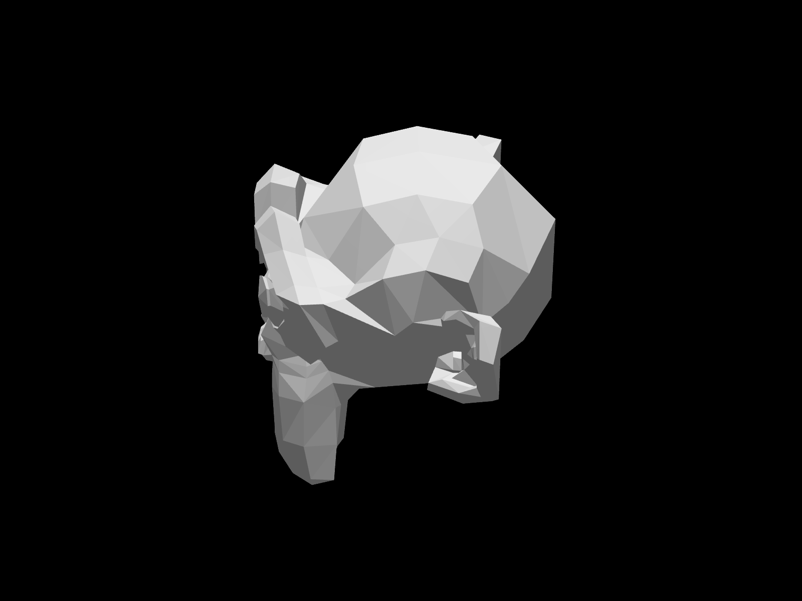
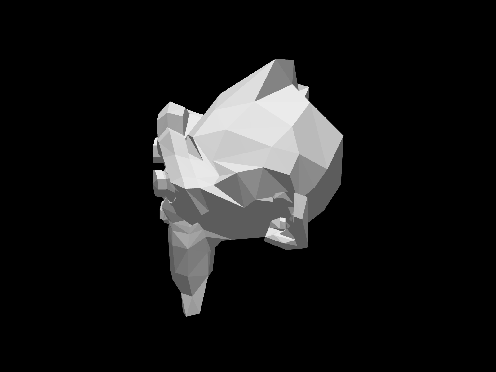
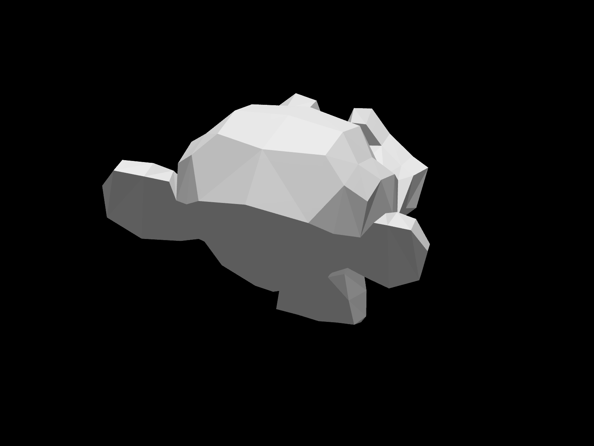
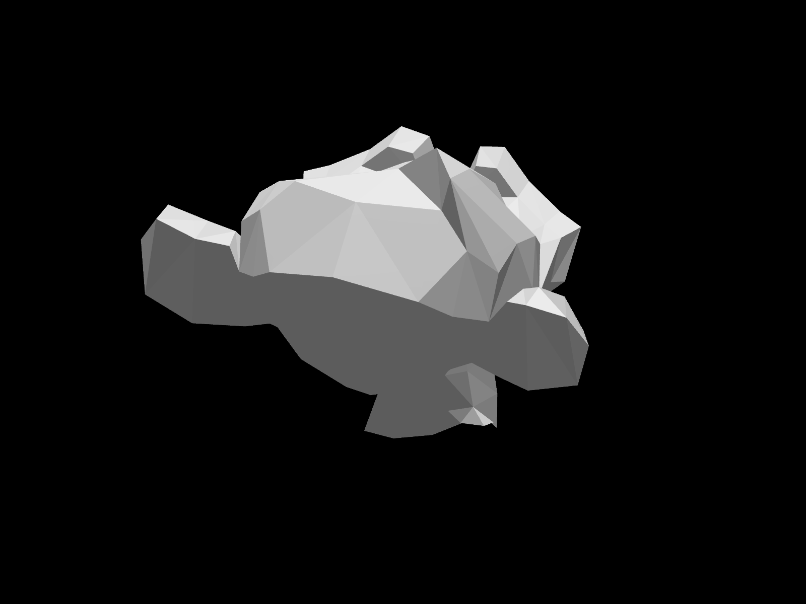
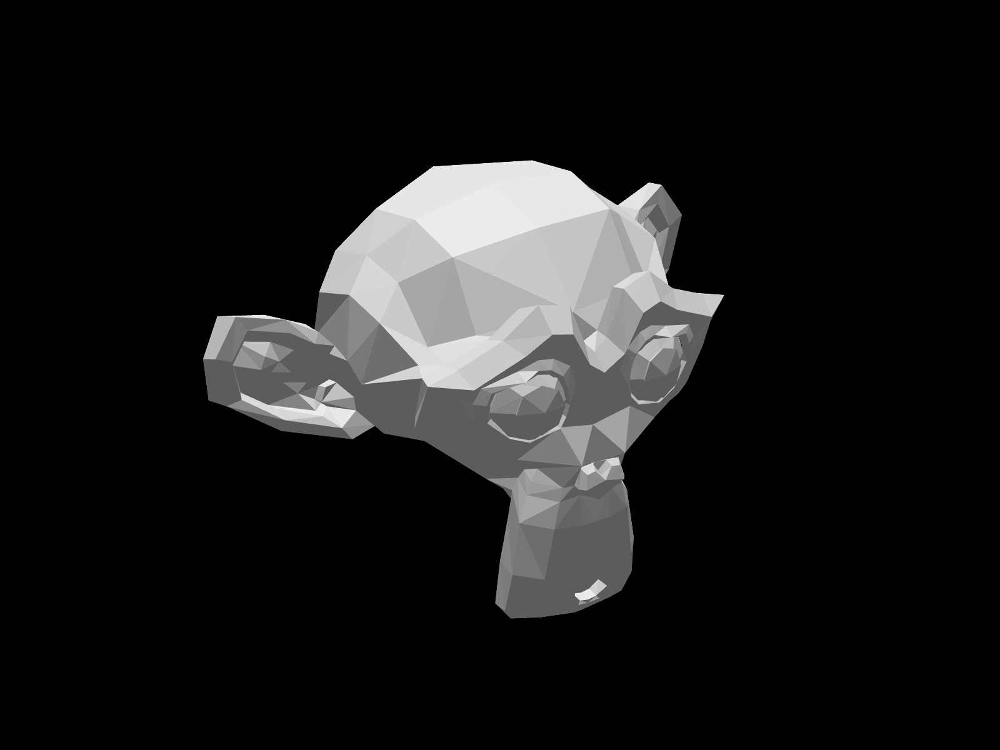
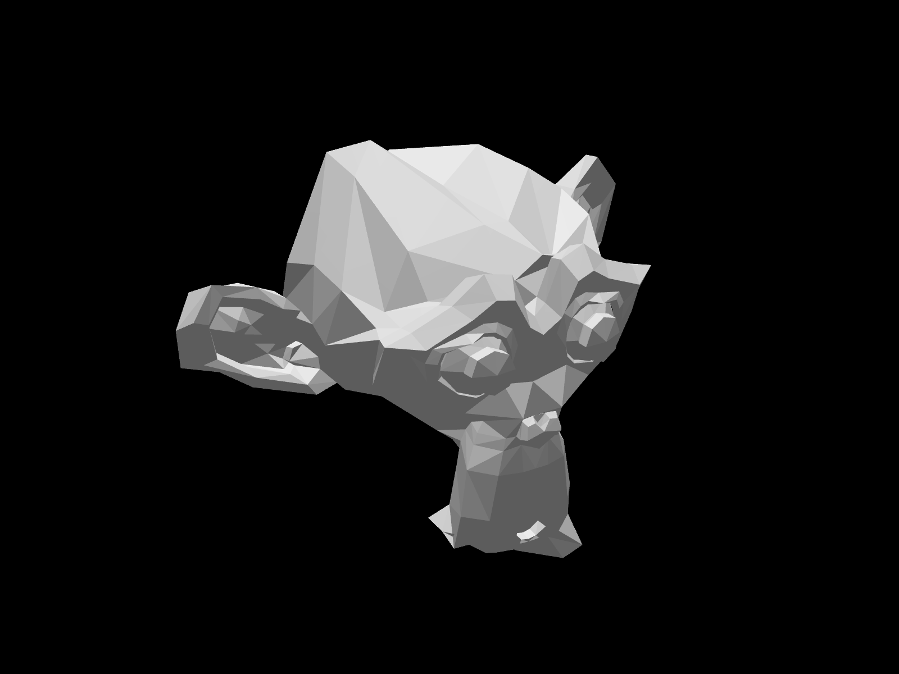
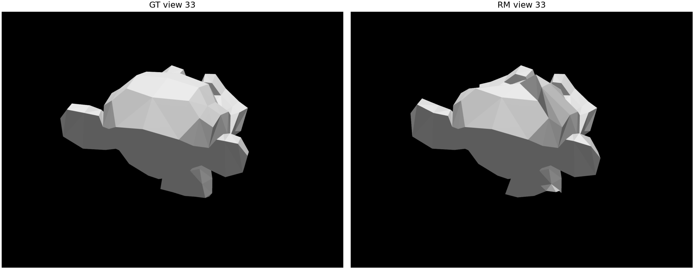
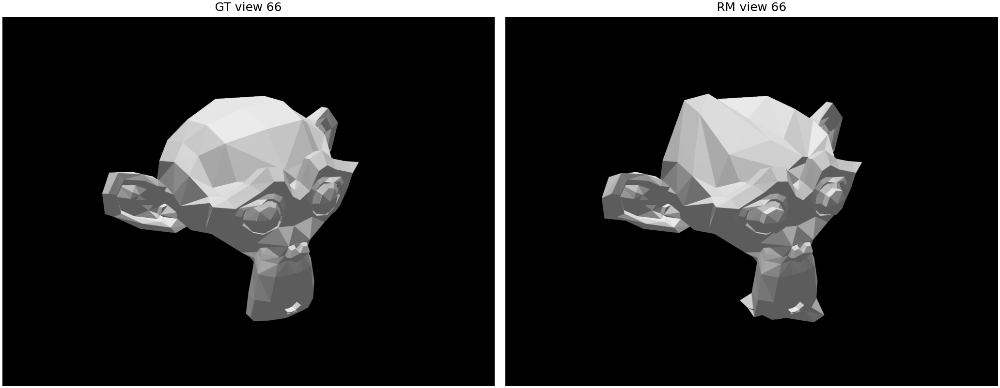

# Resultados de exemplo — registro histórico

> **Escopo:** resultados previamente registrados e versionados em `examples/output/`. A reorganização do código em `src/meshcomparison/` e a GUI PySide6/PyVistaQt **não foram revalidadas por esta publicação**; não trate os números abaixo como benchmark de um novo commit.

Este relatório registra a execução de exemplo dos pipelines geométrico e perceptual com `data/samples/gt.stl` como referência (GT) e `data/samples/mod.stl` como malha avaliada (RM). Os resultados foram gerados localmente e estão disponíveis na pasta [`examples/output/`](../../examples/output/).

Os dois pipelines concluíram essa execução sem erros. Este resultado confirma o fluxo com as malhas de exemplo, mas não substitui os testes sistemáticos com malhas controladas descritos na [etapa 10](../implementation/step-by-step/10-limitacoes-evolucao.md).

## Resumo da execução

- O pipeline geométrico e o pipeline perceptual foram executados com os arquivos de exemplo.
- O MSE simétrico antes do alinhamento foi **0,0000730103** em coordenadas normalizadas, abaixo do limiar configurado de **0,0001**. O alinhamento foi, portanto, ignorado.
- A diagonal da caixa delimitadora da GT foi **3,77537 unidades STL**. Como os arquivos STL não registram unidade física, os valores em unidades originais devem ser interpretados na unidade usada ao criar as malhas.
- O pipeline perceptual avaliou **100 vistas** e salvou imagens de comparação das vistas **1, 33 e 66**.

## Métricas geométricas

| Métrica | Resultado normalizado | Resultado nas unidades originais da GT |
| --- | ---: | ---: |
| MSE simétrico antes do alinhamento | 0,0000730103 | 0,00104065 unidade² |
| MSE simétrico após o alinhamento | 0,0000730103 | 0,00104065 unidade² |
| Chamfer médio | 0,00187183 | 0,00706686 unidade |
| Hausdorff simétrico | 0,0815869 | 0,308021 unidade |
| RMSE simétrico | 0,00854461 | 0,0322591 unidade |

O MSE pré-alinhamento ficou abaixo do limiar de 0,0001, por isso nenhuma transformação de alinhamento foi aplicada nesta execução.

## Métricas perceptuais

Resumo das 100 vistas calculadas:

| Métrica | Mínimo | Mediana | Média | Máximo |
| --- | ---: | ---: | ---: | ---: |
| LPIPS | 0,0995203 | 0,112826 | 0,114771 | 0,138245 |
| PSNR (dB) | 8,94537 | 11,1308 | 10,9587 | 12,6710 |
| SSIM | 0,918553 | 0,930943 | 0,932160 | 0,944466 |

Os valores perceptuais descrevem as renderizações geradas pelo pipeline e dependem da câmera, do enquadramento e das configurações registradas nos arquivos de métricas. Devem ser comparados usando as mesmas configurações.

## Visualizações geradas

As imagens estão organizadas em duas colunas para facilitar a comparação e reduzir o espaço vertical ocupado no relatório.

<table>
  <tr>
    <td width="50%" align="center">
      <strong>Render ortográfico da referência (GT)</strong> 
      
    </td>
    <td width="50%" align="center">
      <strong>Render ortográfico da malha avaliada (RM)</strong> 
      
    </td>
  </tr>
  <tr>
    <td colspan="2" align="center">
      <strong>Heatmap geométrico</strong> 
      
    </td>
  </tr>
</table>

### Renders multivista da GT e da RM

As renderizações da mesma vista aparecem lado a lado para comparar a GT e a RM.

<table>
  <tr>
    <td width="50%" align="center">
      <strong>Vista 1 — GT</strong> 
      
    </td>
    <td width="50%" align="center">
      <strong>Vista 1 — RM</strong> 
      
    </td>
  </tr>
  <tr>
    <td width="50%" align="center">
      <strong>Vista 33 — GT</strong> 
      
    </td>
    <td width="50%" align="center">
      <strong>Vista 33 — RM</strong> 
      
    </td>
  </tr>
  <tr>
    <td width="50%" align="center">
      <strong>Vista 66 — GT</strong> 
      
    </td>
    <td width="50%" align="center">
      <strong>Vista 66 — RM</strong> 
      
    </td>
  </tr>
</table>

### Comparações perceptuais

Cada imagem já mostra GT e RM lado a lado.

  <strong>Vista 1</strong> 
  

  <strong>Vista 33</strong> 
  

  <strong>Vista 66</strong> 
  

## Arquivos de saída

- [`metrics_geometry.csv`](../../examples/output/metrics/metrics_geometry.csv): métricas geométricas agregadas.
- [`metrics_perceptual.csv`](../../examples/output/metrics/metrics_perceptual.csv): resumo estatístico das métricas por vista.
- [`per_view_metrics.csv`](../../examples/output/metrics/per_view_metrics.csv): valores de LPIPS, PSNR e SSIM para cada uma das 100 vistas.
- [`run_metadata.csv`](../../examples/output/metrics/run_metadata.csv): parâmetros e caminhos usados na execução perceptual.
- [`aligned/rm_aligned.ply`](../../examples/output/aligned/rm_aligned.ply): malha avaliada exportada pelo pipeline geométrico.
- [`heatmaps/gt_heatmap_colored.ply`](../../examples/output/heatmaps/gt_heatmap_colored.ply): malha com cores do heatmap.

Os CSVs de execução registram caminhos locais das malhas; eles podem variar em outra máquina. [`environment.yml`](../../environments/environment.yml) lista as dependências gerais, enquanto [`environment-lock.yml`](../../environments/environment-lock.yml) fixa as versões exportadas do ambiente Windows `meshEval`. Esse ambiente usa PyTorch CPU-only, sem CUDA; portanto, a aceleração CUDA não foi testada. O pipeline perceptual executou em CPU. A execução de exemplo não é uma validação end-to-end desses cenários. Há testes unitários de pontos idênticos, deslocamento e transformações, mas a análise sistemática de malhas deslocadas, redimensionadas, com buracos ou densidades diferentes continua pendente na [etapa 10](../implementation/step-by-step/10-limitacoes-evolucao.md). Mais detalhes da instalação e validação estão no [guia de preparação do ambiente](../implementation/step-by-step/01-preparacao-ambiente.md).
