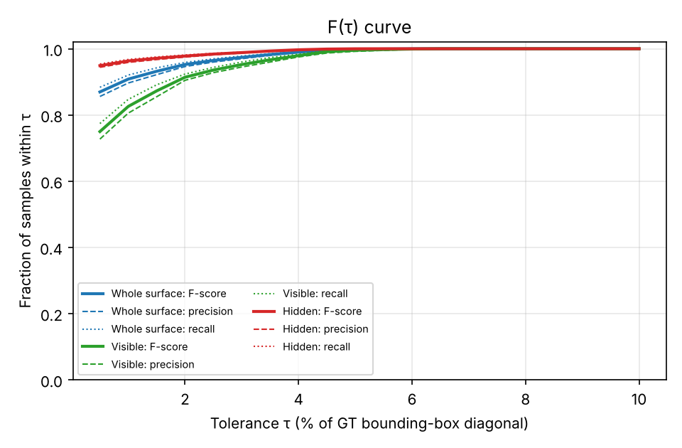
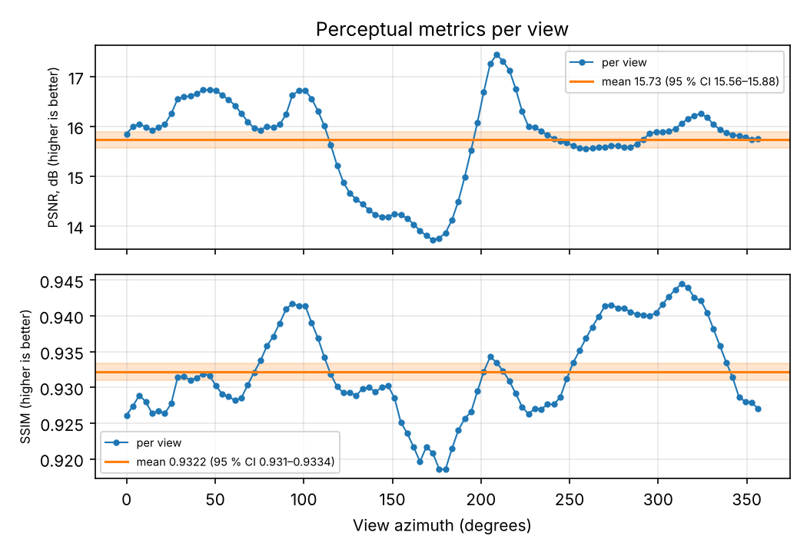

# Resultados de exemplo

Par `data/samples/gt.stl` (GT) × `data/samples/mod.stl` (RM), versão atual dos pipelines, executado em 26/10/2026 (Linux, Python 3.13, NumPy 2.5, Trimesh 5.2, CPU).

- **Preparo:** diagonal da GT = 3,77537 unidades STL; MSE pré-alinhamento (ponto-superfície) = 6,66 × 10⁻⁵ < 10⁻⁴, então o ICP **não** foi acionado.
- **Vista de entrada:** azimute −135° e elevação 25,264°, só como **ilustração**: o par não tem imagem de entrada.
- **Qualidade da GT:** o `check_gt.py` dá WARN para `gt.stl` (3 partes separadas, 2,9 % de arestas de borda, 3,7 % de superfície encerrada). O par serve para demonstrar o software, não como GT de benchmark ([guia das GTs](../gt/README.md)).
- **Dados das figuras:** [`figures/data/`](figures/data/). Cada execução já salva as figuras de métricas por região, F(τ) e perceptual por vista em `<saída>/figures/`; a de incerteza de amostragem exige `python scripts/plot_metrics.py --run <saída> --uncertainty`.

## Métricas geométricas

| Métrica | Inteira | Visível | Oculta |
| --- | ---: | ---: | ---: |
| Parcela da GT | 100 % | 39 % | 61 % |
| Chamfer | 0,0100 | 0,0187 | 0,0042 |
| HD95 | 0,0800 | 0,1195 | 0,0261 |
| F@1% | 0,908 | 0,826 | 0,963 |
| F@2% | 0,952 | 0,914 | 0,978 |
| F@5% | 0,998 | 0,995 | 1,000 |
| AUC‑F | 0,981 | 0,963 | 0,992 |
| NC | 0,960 | 0,928 | 0,980 |

Chamfer e HD95 em unidades da GT; NC = normal consistency; "Inteira" = superfície inteira.

Neste par, o erro se concentra na região visível pela vista ilustrativa: Chamfer 4,4 vezes e HD95 4,6 vezes maiores, e F@1 % 0,14 menor que na região oculta. Com τ ≥ 5 %, praticamente todas as amostras estão dentro da tolerância (F > 0,99): as diferenças entre regiões estão abaixo de ~3 % da diagonal.

## Incerteza de amostragem

Cinco pares de sementes por N (média ± desvio padrão):

- **Sem viés:** com a distância ponto-superfície ([ADR 0004](../adr/0004-point-to-surface.md)), as médias de Chamfer (0,0026 normalizado), F@1 % (0,908) e normal consistency (0,960) são constantes de 10³ a 3 × 10⁵ amostras. Só o HD95, que é um percentil, ainda se desloca abaixo de ~10⁴ amostras.
- **Variação entre sementes:** cai com N; com N = 10⁵, o coeficiente de variação é de 0,8 % (Chamfer), 1,0 % (HD95) e ≤ 0,1 % (F-score, AUC-F, normal consistency).

## Métricas perceptuais

100 vistas, 1600 × 1200 px, elevação 25,264°.

| Estatística | PSNR (dB) | SSIM |
| --- | ---: | ---: |
| Mínimo | 13,72 | 0,9186 |
| P25 | 15,57 | 0,9279 |
| Mediana | 15,90 | 0,9310 |
| P75 | 16,24 | 0,9382 |
| Máximo | 17,44 | 0,9445 |
| Média | 15,73 | 0,9322 |
| IC 95 % da média | 15,56–15,88 | 0,9310–0,9334 |

IC: intervalo bootstrap percentil sobre as vistas.

O **LPIPS não foi calculado** nesta execução, porque os pesos da AlexNet não puderam ser baixados no ambiente. O PSNR e o SSIM não dependem dele. O PSNR cai nas vistas em torno de 150°–190°, a mesma faixa em que o SSIM é mínimo.

## Alinhamento

O ICP não foi acionado neste par. A recuperação de transformações conhecidas e o raio de convergência estão na [validação do ICP](icp/README.md).

## Registro anterior

`examples/output/` guarda uma execução da **versão anterior** (métricas entre vértices; PSNR dividido por N, 4,77 dB abaixo do atual). Esses números não são comparáveis com os acima; as renderizações da GT e da RM continuam válidas como ilustração.
