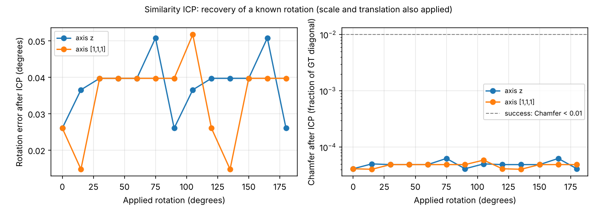

# Validação do alinhamento (ICP de similaridade)

**Método.** A RM é construída aplicando à GT normalizada (`data/samples/gt.stl`) uma similaridade conhecida: rotação de 0° a 180° em passos de 15°, em torno do eixo z e do eixo oblíquo [1, 1, 1], com escala 1,3 e translação de 0,2 da diagonal. O alinhamento é o mesmo do pipeline: MSE ponto-superfície sobre 10⁵ amostras, limiar 10⁻⁴ e `similarity_icp_align`. O erro de rotação é o ângulo da matriz residual (ICP ∘ transformação aplicada), e o ideal é 0.

**Execução:** `python scripts/icp_study.py --gt data/samples/gt.stl --out <pasta>`. Dados em [icp_recovery.csv](icp_recovery.csv).

## Resultado

Com a inicialização global ([ADR 0005](../../adr/0005-icp-global-start.md)), **todas as 26 rotações foram recuperadas**:

- **Rotação:** erro ≤ 0,05°.
- **Escala:** erro ≤ 0,008 %.
- **Translação:** erro ≤ 10⁻⁴ da diagonal.
- **Métricas pós-alinhamento:** Chamfer ≤ 6,3 × 10⁻⁵ e F@1 % = 1.

**Antes**, com uma única partida, só 9 de 26 casos convergiam: até 30° no eixo z e 45° no eixo oblíquo. Nas falhas, o Chamfer pós-alinhamento ficava em 2,5–3,1 % da diagonal, valor que parece uma reconstrução ruim e não um erro de alinhamento.

## Limites

- **Uma forma:** o resultado vale para esta GT. Objetos com simetrias podem ser alinhados em orientações equivalentes, sem efeito nas métricas.
- **Cópias exatas:** a varredura usa cópias transformadas. Com reconstruções reais, a partida escolhida é a de menor distância, que pode não ser a orientação "pretendida" pelo modelo. Inspecione `icp_scale` e o heatmap.
- **Testes:** `tests/test_icp.py` verifica 15° (com escala e translação), 90°, 120°, 135° e 180° numa forma sem simetria, a identidade sem ICP e o caminho completo do pipeline.
