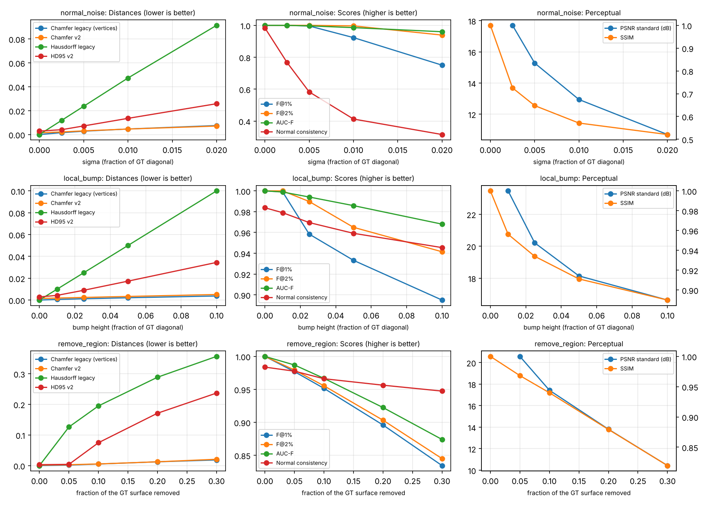

# Estudo de invariância e sensibilidade das métricas (ADR 0002)

Este estudo testa se as métricas obedecem aos três *priors* geométricos usados em *Geometric Deep Learning* (Bronstein, Bruna, Cohen e Veličković, arXiv:2104.13478, 2021): **invariância** a transformações que não mudam a forma, **estabilidade** (pequenas distorções devem gerar pequenas mudanças) e **multiescala** (curva F(τ)). Ele foi pensado como seção de validação de um artigo para a IJCNN 2027.

- **Comando:** `python scripts/robustness_study.py --gt data/samples/gt.stl --out <pasta> --views 8` (`PYOPENGL_PLATFORM=egl` em Linux sem tela).
- **Parâmetros registrados:** [study_parameters.csv](study_parameters.csv). GT normalizada pela diagonal (CC-02); `N = 100 000` amostras; sementes `0`/`1`; **sem ICP** (a intenção é isolar a resposta das métricas); 8 vistas perceptuais de 320 × 240 px.
- **Limitações desta execução:** há **uma única GT** (a peça de exemplo); o LPIPS **não** foi calculado, porque o download dos pesos da AlexNet foi bloqueado no ambiente (*environment-blocked*). Repita o estudo com as GTs do benchmark e com `--lpips` antes de usar os números no artigo.

## 1. Invariância à triangulação

Arquivo: [invariance.csv](invariance.csv). A RM é **a mesma superfície** da GT, só com outra discretização.

| Variante (mesma superfície) | Vértices | Chamfer legado | Hausdorff legado | Chamfer v2 | HD95 v2 | F@1 % | AUC-F | Normal consistency |
| --- | ---: | ---: | ---: | ---: | ---: | ---: | ---: | ---: |
| Cópia idêntica | 2 904 | 0 | 0 | 0,0015 | 0,0029 | 1,000 | 1,000 | 0,983 |
| Ordem dos vértices permutada | 2 904 | 0 | 0 | 0,0015 | 0,0029 | 1,000 | 1,000 | 0,983 |
| Subdividida ×1 | 5 808 | 0,0048 | 0,0888 | 0,0015 | 0,0029 | 1,000 | 1,000 | 0,983 |
| Subdividida ×2 | 14 520 | 0,0058 | 0,0888 | 0,0015 | 0,0029 | 1,000 | 1,000 | 0,983 |
| Metade subdividida ×2 (densidade desigual) | 8 712 | 0,0048 | 0,0888 | 0,0015 | 0,0029 | 1,000 | 1,000 | 0,984 |

Valores normalizados pela diagonal da GT.

**Leitura:**

- As métricas **legadas por vértice não são invariantes à re-triangulação**. Para a mesma superfície, o Hausdorff passa de 0 para 0,089, que é 8,9 % da diagonal.
- As métricas v2 não mudam. O valor não nulo da cópia idêntica é o **piso de amostragem**: duas amostragens independentes da mesma superfície. Esse piso deve ser relatado no artigo.
- A normal consistency tem piso de 0,983 nesta peça, por causa das arestas vivas: amostras vizinhas de faces diferentes têm normais diferentes.

## 2. Sensibilidade a perturbações controladas

Arquivos: [sensitivity.csv](sensitivity.csv) e figura [sensitivity.png](sensitivity.png). A base é a GT subdividida até 43 560 vértices, para que as perturbações locais sejam resolvidas.

**Leitura (só para esta GT):**

- **Todas as métricas pioram de forma monotônica** com a intensidade nas três perturbações. Nenhuma inversão de tendência foi observada.
- **Ruído na direção da normal:** o Chamfer e o HD95 mudam pouco; a **normal consistency cai de 0,98 para 0,77 já com σ = 0,25 %**. Ela mede rugosidade e orientação local, que as distâncias quase não captam. Isso justifica mantê-la como métrica complementar.
- **Saliência local:** o Hausdorff legado é igual à altura da saliência, pois só mede o pior ponto. O **F@1 %** é o que mais separa os níveis (de 1,00 para 0,90). O Chamfer quase não muda: um erro local se dilui na média.
- **Remoção de superfície (incompletude):** o **F-score e a AUC-F caem quase de forma linear** com a fração removida (cobertura). O Chamfer v2 sobe pouco. O HD95 só reage a partir de cerca de 10 %, porque ignora os 5 % piores pontos de cada direção.
- **PSNR padrão e SSIM** também são monotônicos, mas misturam silhueta e sombreamento; o PSNR é `+∞` (omitido, CC-11) para a cópia idêntica.

## 3. Roteiro sugerido para o artigo (IJCNN, 6 páginas)

1. **Motivação:** avaliar modelos *image-to-3D* (TripoSR, Stable Fast 3D, InstantMesh) exige métricas confiáveis.
2. **Métricas como funções sobre variedades discretizadas:** os *priors* de invariância, estabilidade e multiescala viram requisitos verificáveis.
3. **Protocolo evaluation-v2:** amostragem, Chamfer, HD95, F@τ e AUC-F, normal consistency, PSNR padrão, regiões visíveis × ocultas e escala do ICP ([ADR 0001](../../adr/0001-evaluation-v2.md), [ADR 0002](../../adr/0002-robustness-study.md)).
4. **Validação das métricas:** as tabelas e a figura acima, repetidas para as GTs do benchmark.
5. **Benchmark:** métricas globais, visível × oculto e correlação entre métricas geométricas e perceptuais.
6. **Limitações e reprodutibilidade:** câmera ortográfica, ICP local, LPIPS com crop; sementes, versões e hashes.

Cite a fonte primária (Bronstein et al., 2021), não o post introdutório de blog.
